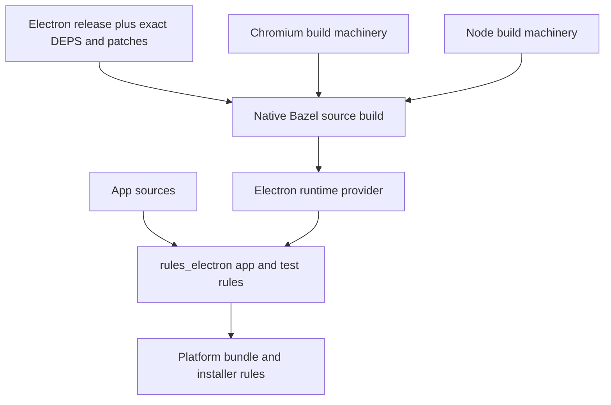

# Electron rules ownership

This repository owns the `electron` BCR source overlay. A separate
`rules_electron` repository will own app-facing build and packaging rules.

- Future `rules_electron` owns app composition, runtime selection, launch/tests, native
  addon ABI, ASAR, platform bundles and installers. Signing needs explicit
  platform tools and credentials.
- This repository owns exact Electron dependency revisions, ordered patches,
  generated sources, snapshots and native linking. Host Node tools stay separate
  from target Electron's embedded Node.
- Reuse Chromium/Node build machinery. Stock libnode and a standalone Chromium
  build do not establish an Electron-compatible runtime. Preserve matching
  V8, ICU and BoringSSL across the embedded runtime.
- First source milestone: Linux x86_64 executable launching BrowserWindow,
  preload and IPC. Existing packaging and partial source builds do not meet it.

Upstream findings checked November 6, 2026:

- [Bazel registries](https://bazel.build/external/registry) support source overlays
  and patches; they can distribute either source modules or rulesets.
- [hermeticbuild/nodejs](https://github.com/hermeticbuild/nodejs) supports stock
  Node 26.3.1 and source-built execution/runtime toolchains. Its supported release
  differs from this workspace's Electron 39 / Node 22.20.0 profile.
- [formatjs/chromium](https://github.com/formatjs/chromium/blob/main/README.md)
  reports a validated native Linux Chromium browser; no modules published yet.
- [Electron patches](https://www.electronjs.org/docs/latest/development/patches)
  and [DEPS](https://github.com/electron/electron/blob/v39.0.0/DEPS) define the
  matched source closure.
- [Native addons](https://www.electronjs.org/docs/latest/tutorial/using-native-node-modules/)
  require Electron ABI compatibility; Windows also needs its import library and
  delay-load hook.
