# Electron source import

This overlay builds native Electron source components, including the complete
V8 engine, generated snapshots, Chromium base, patched libnode and native
Mojo/networking. No target
currently links a full Electron executable. Source pins and build inputs live in
`bcr/overlay/source`.
Compilation uses native Bazel rules and declared generators, without CMake or
`rules_foreign_cc` wrappers.
Stage a local registry first as shown in the root README; add its registry flags
to every Bazel command below. Desktop source targets use
`--platforms=@electron//source/platforms:linux_amd64`, matching the pinned
Chromium SDK’s glibc 2.31 floor. Development and consumer checks set this default;
cross probes select their own target platforms. Native source work:

- Electron 39.0.0, Chromium 142.0.7444.52 commit
  `7efca501bfcc84657ba2921a852e98ce1fb37641`, Node 22.20.0 and V8
  `bb294624702efbb17691b642333f06bf5108e600` are pinned.
- Bazel applies all 14 ordered patch stacks: 236 upstream patches. Exact
  revisions and patch filenames live in upstream_pins.json; 718 modified source
  files are checked against patch_fingerprints.json.
- Patched libuv builds/links for five platforms; Linux test executes its
  Electron-specific loop-interrupt API. Windows uses MSVC.
- Real patched JS2C builds and emits embedder builtin C++ with separate host
  execution configuration. Full Node builtin generation also produces all
  370 registered modules, including 14 real original-fs outputs and target
  config.gypi. The config output matches upstream's GN-driven script
  byte-for-byte. This configuration is Linux AMD64 only; independent original-fs
  and embedder producers also execute under a Windows ARM64 target configuration.
  Electron fuse and Chromium buildflag generators
  produce actual Electron C++; native fuse-wire/default test passes. Full
  patched BoringSSL crypto/TLS compiles and passes RIPEMD160, cipher lookup
  and AES-CFB roundtrip checks. Crypto/TLS also cross-links all five platforms;
  Linux GNU 2.31 probe executes. Real Node macro-isolation generation passes
  a compiled push/undef/pop integration test.
- GN 2285 (`81b24e01531e`) loads 27,558 targets. Chromium's strict capture tool
  validates the complete 11,955-target Electron closure, 4,570 runtime entries
  and generated-file contents. `native/linux_amd64.partial.json.gz` records
  exact tool hashes, arguments, all 14 applied patch groups and fingerprint hash.

The metadata tree reuses matching-DEPS checkout files read-only. It must not
be used to compile or package Electron. All Electron patch groups are now
applied, including nested Squirrel/Mantle/ReactiveObjC dependencies. Other
Chromium dependencies still need explicit source/Bazel declarations before
full native translation. Other four source graphs also remain. No GN/Ninja
build runs inside Bazel actions.

Patched `//third_party/electron_node:libnode` now builds its 171 C/C++ units and
executes a real embedding probe. Next native producer:
`//electron:electron_lib` has 315 units plus its Chromium dependency closure. Node's `run_node_js2c`,
`generate_config_gypi` and `node_js2c_original_fs` now have native Bazel
producers. All eight Electron webpack bundles now build using actual upstream
configurations, captured buildflags and 141 integrity-pinned packages
from its exact yarn.lock. Pinned Node 22.20.0 comes from rules_nodejs execution
toolchains; this bootstrap is an official runtime, not source-built Node.
These bundles currently transpile without typechecking; TypeScript definition
generation remains unfinished. `@electron//source:electron_natives` runs actual C++ JS2C
with all eight canonical `electron/js2c/*` module names.
The remaining Chromium import needs matching Blink/content libraries and
runtime packaging. No target currently links a source-built
Electron executable.

`bazel test @electron//tests:node_builtins_test` runs the actual full Node producer
chain. It checks regular fs and isolated original-fs registration/payloads,
native module ABI 140, NAPI 10, V8 sandbox/pointer compression and target
configuration embedded as JSON. No GN process runs inside these actions.

`@electron//tests:electron_bundles_test` parses all eight emitted bundles with
pinned Node and verifies lossless one-byte and two-byte C++ embedding. Earlier
app-level bundle smoke used official Electron binaries; that packaging example
now belongs with the future app rules repository. Source tests do not establish
that a source-built Electron runtime launches.

The npm closure includes exact required/optional lock dependencies, explicit
webpack/TypeScript peers and the config's terser import. This is a bounded
Electron source tool closure, not a general npm package manager. Packages copy
into a private staging tree; Node resolves their exact dependency links there.
No install hooks run; sandbox actions deny network on Linux.

The native BoringSSL overlay mirrors Electron's extra crypto source list. Its
GN list includes obsolete `decrepit/ripemd/internal.h`; that nonexistent header
is excluded, and the real `decrepit/macros.h` dependency is declared explicitly.

## Native Node dependencies

The Linux AMD64 profile declares Ada, c-ares, HdrHistogram, llhttp, nbytes, ncrypto,
nghttp2, Postject, simdjson, SQLite and uvwasi from the pinned patched Node tree.
Ten compiled libraries contain 136 C/C++ units; Postject is header-only. All
effective definitions and language-specific options come from the verified GN
capture. Hermetic LLVM supplies compiler/sysroot/libc++; omitted global include
roots and toolchain/diagnostic flags remain recorded. Unsupported dependency
edges fail import rather than substituting another library version.

`@electron//source:node_dependencies_test` consumes all eleven libraries and checks
URL/JSON/HTTP parsing, IPv6 conversion, histogram recording, HTTP/2 settings,
SQLite FTS5/session configuration and WASI argument transfer.
[9395812 source components](https://formatjs.buildbuddy.io/invocation/6f893782-be77-4e46-a6ff-030d79cdc260)
and [BCR consumer](https://formatjs.buildbuddy.io/invocation/52bfde1b-8468-476d-9866-109a133c1935)
both passed compilation and the linked probe. This does not link libnode or
Electron. Other target profiles remain unsupported for these libraries.

ncrypto uses the existing Electron-patched BoringSSL provider; its GN include
mapping remains recorded. The linked probe also checks unaligned byte swaps
and invalid lengths, the
[RFC 5869 A.1 HKDF vector](https://www.rfc-editor.org/rfc/rfc5869.html#appendix-A.1)
and output-length limits, plus Postject lookup of a declared ELF note and missing
resources. The execution toolchain assembles the fixture note, linked statically
into the main test executable because Postject searches that executable. No host
binary editing tool or alternate crypto runtime is used.

Regenerate the inventory from the same graph:

```sh
python3 tools/capture_node_deps.py --graph=bcr/overlay/source/native/linux_amd64.partial.json.gz \
  --output=bcr/overlay/source/native/node_deps_inputs.bzl
buildifier bcr/overlay/source/native/node_deps_inputs.bzl
```

## Complete Torque generation

`@electron//source:v8_torque` builds the matching Torque compiler from 25 captured
C++ units and translates all 246 upstream `.tq` inputs into 1,250 declared engine
outputs. It preserves captured source order, exceptions/RTTI and Electron's
sandbox, Temporal, Intl and Perfetto definitions. Hermetic LLVM replaces source
toolchain/sysroot options; original dependencies, includes and omitted flags
remain recorded. No default V8 feature profile substitutes for this capture.

The action invokes the execution compiler directly through declared Python,
using stable source-relative arguments. The initial profile runs twice under
different source/output paths and input mtimes, then requires byte equality for
every output. A manifest records profile provenance and output hashes; output
groups expose headers and C++ sources for the remaining engine build. Tests
check generated engine/Intl/Temporal interfaces and malformed-input rejection.
Torque embeds its V8 root in source locations, so the runner passes `.` from
each isolated source directory. It also creates every declared output parent;
the upstream compiler assumes those directories already exist.

[93dc092 source components](https://formatjs.buildbuddy.io/invocation/0a295b37-7dc5-4a45-b395-e8e210eb1620)
and [BCR consumer](https://formatjs.buildbuddy.io/invocation/e338b62e-75ae-4a3e-b5fd-21279b2f4cd3)
passed complete generation, byte reproducibility, output hash/interface checks
and the real parser diagnostic/abort check. Core dumps are disabled for that
negative test. The cross-compile workflow also passed; this Torque profile
itself remains Linux AMD64. Full engine validation is recorded below; libnode
and the Electron executable remain unfinished.

```sh
python3 tools/capture_v8_torque.py --graph=bcr/overlay/source/native/linux_amd64.partial.json.gz \
  --output=bcr/overlay/source/native/v8_torque_inputs.bzl
buildifier bcr/overlay/source/native/v8_torque_inputs.bzl
```

## Bytecode handler generation

`@electron//source:v8_bytecodes` builds the captured three-unit upstream
generator and emits `builtins-generated/bytecodes-builtins-list.h`. Interpreter
support is shared with a compiled probe; Torque and bytecode tools share the
same pinned header provider. All effective definitions and language options
come from the Electron graph. No GN wrapper, system interpreter or alternate
V8 profile runs in the generation action.

`@electron//source:v8_bytecodes_test` compiles the actual generated handler
macro and checks every opcode at all three operand scales against V8's
interpreter API: handler names, coverage, uniqueness, illegal wide encodings
and dense wide/extra-wide dispatch indices. A second generation uses a
different output path containing spaces; the probe compares all bytes.
Production consumers depend only on the first generation. Hosted validation
passed in [1395ef7 components](https://formatjs.buildbuddy.io/invocation/939077e6-f2cf-4874-8d8f-99b8becb0f72)
and [BCR consumer](https://formatjs.buildbuddy.io/invocation/4dedcd9e-2880-4aec-8a0e-d2fbacf123e4),
including the existing full Torque checks. This does not link the V8 engine.

```sh
python3 tools/capture_v8_bytecodes.py --graph=bcr/overlay/source/native/linux_amd64.partial.json.gz \
  --output=bcr/overlay/source/native/v8_bytecode_inputs.bzl
buildifier bcr/overlay/source/native/v8_bytecode_inputs.bzl
```

## Regexp special-case generation

`@electron//source:v8_regexp` builds the captured `gen-regexp-special-case`
execution tool against matching patched V8 and Chromium ICU, then emits real
`src/regexp/special-case.cc`. It preserves the complete Electron definitions and
source flags. Bytecode and regexp generation share a direct Bazel action;
neither invokes the GN Python wrapper.

The compiled `@electron//source:v8_regexp_test` consumes those generated tables
and disables ambient ICU data-file access. It checks legacy ignore-case
matching for Kelvin sign, long s, sharp s, Greek mu and ordinary ASCII, plus
surrogate/canonicalization boundaries. A second output path contains spaces;
every generated byte must match.
[b98e496 components](https://formatjs.buildbuddy.io/invocation/3bc9b5ed-9f34-4053-ba0f-808adc539d5b)
and [BCR consumer](https://formatjs.buildbuddy.io/invocation/e936e28b-4f42-4864-96be-8c7127086717)
passed these checks and existing source tests. Cross-compile CI also passed;
this producer remains Linux AMD64.

V8's repository BUILD file now delegates to a stable source macro. Further
native rule edits do not need to change the BUILD template read during source
repository setup. The existing bytecode inventory regenerates byte-for-byte
after sharing its capture logic with the new generator. Full V8/Electron
linking remains unfinished.

```sh
python3 tools/capture_v8_generators.py --generator=regexp \
  --graph=bcr/overlay/source/native/linux_amd64.partial.json.gz \
  --output=bcr/overlay/source/native/v8_regexp_inputs.bzl
buildifier bcr/overlay/source/native/v8_regexp_inputs.bzl
```

## Matching Chromium ICU

`@electron_icu_sources//:icu` declares all 445 captured C++ units: 202 common
units, including upstream stub data, and 243 i18n units. Source revision
`1b2e3e8a421efae36141a7b932b41e315b089af8` and archive integrity match
formatjs/chromium's ICU overlay; repository setup also verifies the revision
against Electron's patched Chromium DEPS. Compile options, RTTI, definitions,
headers and dependency edges come from this Electron capture.
The header inventory includes GN's separate public lists and the real
`stubdata.h` include omitted from those lists. Upstream subset Bazel packages
are replaced by this captured graph; ICU sources and data remain unchanged.

The profile retains file-backed data. `common/icudtl.dat` is declared runtime
data for later packaging, rather than host ICU data or a different
ICU version. `@electron//source:icu_test` disables ambient data-file loading,
rejects corrupt common data, then initializes from that declared file. It
checks NFC composition, case-fold preflight/expansion, collation strengths,
French number formatting and Chromium's patched word-break behavior.
[fe62420 source components](https://formatjs.buildbuddy.io/invocation/63616e6c-424b-4f71-8962-5903b4a10113)
and [BCR consumer](https://formatjs.buildbuddy.io/invocation/23d317a4-9381-4466-a904-6afb3bb4a61d)
passed all compilation and these behavior checks; cross-compile CI also passed.
This captured ICU profile itself remains Linux AMD64. Its repository rule is
separate from Node/V8 repository implementations so future ICU setup edits do
not change their definition files. `//:source_components` requests both actual
ICU archives through `//source:icu_libraries`; building the dependency-only C++
provider alone would not request both archives. The full engine now consumes
these archives; final Electron linking remains unfinished.

The build-only component phase uses `--remote_download_outputs=minimal` so
compile-only archives remain in BB CAS. The following test phase retains
top-level downloads for its executables and declared runtime data.

```sh
python3 tools/capture_icu.py --graph=bcr/overlay/source/native/linux_amd64.partial.json.gz \
  --output=bcr/overlay/source/native/icu_inputs.bzl
buildifier bcr/overlay/source/native/icu_inputs.bzl
```

## Captured PartitionAlloc

Temporal's Rust closure uses Chromium's allocator. The matching native
PartitionAlloc profile contains 66 C++ units across allocator base, core and
shim archives. An isolated repository projects these source bytes read-only
from the exact patched Chromium tree; it downloads no alternate version.
Captured flags and upstream buildflag generation retain the malloc shim,
backup-ref-pointer and thread-isolation settings.

`@electron//source:partition_alloc_test` links the real shim and checks heap
ownership, allocation/zeroing, realloc preservation and failed-realloc safety,
overflow handling and aligned allocation/reallocation. A child process checks
the upstream SIGILL trap on calloc multiplication overflow and SIGTRAP on
allocation-metadata overflow, with core dumps disabled. A valid huge request
and failed realloc must still return null.
It also checks that
ordinary `malloc` and C++ `new` use PartitionAlloc. No replacement allocator or
allocation stub supplies this prerequisite.
[5b7f211 source components](https://formatjs.buildbuddy.io/invocation/c0fd8cbf-f5c9-4994-a64a-c6dec789b10b)
and [BCR consumer](https://formatjs.buildbuddy.io/invocation/e50d8faf-cf75-49ac-8891-b726caf63db5)
passed archive compilation and all probe boundaries. Cross-compile CI also
passed; this PartitionAlloc profile itself is Linux AMD64. The following
Temporal slice now links this allocator through its original Rust bridge.

```sh
python3 tools/capture_partition_alloc.py \
  --graph=bcr/overlay/source/native/linux_amd64.partial.json.gz \
  --source-root=/path/to/matching/patched/chromium \
  --output=bcr/overlay/source/native/partition_alloc_inputs.bzl
buildifier bcr/overlay/source/native/partition_alloc_inputs.bzl
```

## Temporal Rust and allocator FFI

The captured Temporal closure declares 57 Rust targets from 44 pinned vendor
packages, including six original build scripts, proc macros and both allocator
variants. Three C++ bridge variants use Chromium's original allocator/error
handler sources. Runtime Rust keeps `rust_allocator_uses_allocator_impls_h` and
real PartitionAlloc-backed FFI; host variants retain their captured settings.
Native bindgen generates the original `bindings.rs` namespace wrapper inputs.

`hermeticbuild/rules_rs` 0.2.1 supplies native Rust actions. Development and BCR
consumer configurations register nightly/2025-09-25 and select the nightly
channel. Compiler target/metadata choices come from those declared providers;
captured features, editions, codegen and warning options remain explicit.
Source projection lists every crate input, checks Cargo.toml versions and maps
generated OUT_DIR/CARGO_MANIFEST_DIR paths. Dependencies come from the captured
graph; original build scripts run against declared inputs.

The one-unit V8 `ZoneInfo64Provider` uses its real upstream implementation and
the captured engine flags. `@electron//source:temporal_test` initializes declared
ICU data with ambient data-file loading disabled, then checks Rust allocation
ownership and fallible reserve, leap dates, rejection/constraining, calendar
arithmetic, Japanese calendar data and New York DST/gap behavior through that
actual provider.
[3278609 source components](https://formatjs.buildbuddy.io/invocation/df7fed7a-c08b-46f4-be2d-dcb6467631df),
[BCR consumer](https://formatjs.buildbuddy.io/invocation/75b513b8-c73b-4fb4-a035-0122c0ed452d)
and [cross-compile checks](https://formatjs.buildbuddy.io/invocation/a9818842-360f-4d7f-ad60-29fd3732546c)
passed. This Linux AMD64 slice does not link the full V8 or Electron engine.

```sh
python3 tools/capture_temporal.py \
  --graph=bcr/overlay/source/native/linux_amd64.partial.json.gz \
  --source-root=/path/to/matching/patched/chromium \
  --fontconfig-root=/path/to/fontconfig-f0ed9c3f43161d3555f6f7a5234b22fe7ca60727 \
  --skia-root=/path/to/skia-f4ed99d2443962782cf5f8b4dd27179f131e7cbe \
  --output=bcr/overlay/source/native/temporal_inputs.json \
  --v8-output=bcr/overlay/source/native/v8_temporal_inputs.bzl
buildifier bcr/overlay/source/native/v8_temporal_inputs.bzl
```

## Full V8 engine and snapshots

The complete patched V8 engine now builds, links and executes. Native consumers
use `@electron_v8_engine_sources//:v8`, `:platform` and declared `:runtime` data.
Its 34 native targets add 1,453 C++/assembly compilation units; existing
libbase/libm and execution generators remain shared dependencies. Inspector uses
original compatibility checks, templates and declared Jinja2/MarkupSafe inputs.
FP16 uses Chromium's exact DEPS revision and a hashed archive.

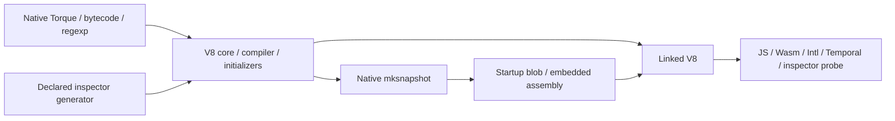

The profile projects 3,047 declared files. Generated layout aliases reuse
all 1,250 Torque outputs and the existing native producer. Snapshot creation
keeps the captured architecture/OS, predictable mode and seed `314159265`.
Upstream `mksnapshot` calls `CpuFeatures::Probe(true)`, disabling host CPU
probing for target code generation. Each native Python action, including
snapshot generation, requires byte equality across changed staging paths and
input mtimes. `:runtime` exposes the generated startup blob and matching ICU data.

The hermetic SDK needs explicit `<atomic>`/`<memory>` includes in Wasm `pgo.h`.
`v8_header_compat.patch` applies only to an owned projection copy; parent patched
V8 sources stay unchanged. `native_toolchain_patches.json` records that boundary.
The shared header provider exposes matching native Abseil dependencies instead
of relying on GN's implicit include-root access. Captured feature flags remain
intact, including pointer compression, sandbox, Intl and Perfetto.

`@electron//source:v8_engine_test` initializes the actual generated snapshot and
ICU data, executes a Wasm add function, JS collection operations, Unicode/locale
behavior and Rust-backed Temporal DST/rejection paths. It dispatches inspector
`Runtime.evaluate`, checks the decoded result, tests syntax-error reporting and
checks context state after collection.
[4516ed7 components](https://formatjs.buildbuddy.io/invocation/4d39e515-418d-4f13-a1ec-2a4b5484c4d0),
[BCR consumer](https://formatjs.buildbuddy.io/invocation/ec9a0537-868a-4182-9ec0-ded5e613b4ef)
and [cross checks](https://formatjs.buildbuddy.io/invocation/4340b427-110a-46b5-a4be-84f4828020d0)
passed. This full engine profile remains Linux AMD64. Patched libnode,
Electron/Chromium content linking and complete runtime packaging remain open.

```sh
python3 tools/capture_v8_engine.py \
  --graph=bcr/overlay/source/native/linux_amd64.partial.json.gz \
  --v8-root=/path/to/matching/patched/v8 \
  --chromium-root=/path/to/matching/patched/chromium \
  --fp16-root=/path/to/pinned/FP16 \
  --output=bcr/overlay/source/native/v8_engine_inputs.json
```

## Complete captured Perfetto closure

The native profile translates all 329 captured Perfetto targets plus matching
JsonCpp: 68 original generator actions, 721 generated outputs and 564 C++
compilation units, including generated protocol implementations and host
plugins. Source sets retain object inclusion semantics; each target keeps its
captured compiler flags, definitions and dependencies.

Perfetto comes from Electron's patched `d5bbee7afdf259af4212929ccbff467dd5349953`
source. JsonCpp uses Chromium's exact DEPS revision
`42e892d96e47b1f6e29844cc705e148ec4856448` and a hashed archive, rather than a
newer BCR version. Its iterator `.inl` is a declared implementation input.
The projection declares 1,463 source/header/schema/script/license files.

The original protoc wrapper, buildflag writer, descriptor/table generators and
stamp script run through a declared Python action. Native protoc/plugins are
execution-platform inputs. Child processes get isolated Python, empty `PATH`
and an explicit environment. Every generator runs twice with different staging
paths, including spaces, and different source mtimes; output bytes must match.
The registered LLVM toolchain supplies the compiler-runtime archive formerly
named through GN's `$LLVM_ROOT`; no source action resolves that host path.

`@electron//source:perfetto_test` starts/stops real in-process tracing, decodes
packet-scoped interned names and debug annotations, and checks disabled-category
filtering. It also checks binary-string JsonCpp roundtrips and its captured
abort-on-invalid-conversion behavior, with core dumps disabled.
[7177c35 components](https://formatjs.buildbuddy.io/invocation/3072778c-6b5f-4d26-ad16-aa721e45c7f4),
[BCR consumer](https://formatjs.buildbuddy.io/invocation/781d378c-801e-46f9-a1a9-45bfd2007deb)
and [cross checks](https://formatjs.buildbuddy.io/invocation/73a5d16b-bf93-4f1a-8e97-25159bb6bb41)
passed. These native profiles remain Linux AMD64. The full engine now consumes
this tracing closure; final Electron linking remains open.

```sh
python3 tools/capture_perfetto.py \
  --graph=bcr/overlay/source/native/linux_amd64.partial.json.gz \
  --chromium-root=/path/to/matching/patched/chromium \
  --perfetto-root=/path/to/matching/patched/perfetto \
  --jsoncpp-root=/path/to/pinned/jsoncpp \
  --output=bcr/overlay/source/native/perfetto_inputs.json
```

## Matching Protobuf runtime and compiler

Perfetto's generators require a matching protocol tool/runtime. The native
profile builds Chromium's embedded Protobuf 32.0 rather than substituting the
newer BCR module. Twelve original targets contain 129 C/C++ units: UTF-8 support,
full/lite runtimes, protoc, its C++/Java/Python compiler libraries and the original
JavaScript plugin dependency. That plugin uses Chromium's exact DEPS revision
`e6d763860001ba1a76a63adcff5efb12b1c96024` with a hashed archive.

The profile declares 1,110 source/header/schema/license files, preserves captured
compiler flags and keeps `GOOGLE_PROTOBUF_NO_RTTI` and
`PROTOBUF_INTERNAL_BOUNDS_CHECK_MODE_ABORT` consistent through generated code.
Abseil comes from the matching Chromium tree. Its public `base` target carries
the private raw-logging dependency; no visibility override or duplicate source
copy is needed. Protoc is an explicit execution-platform binary with its plugin
runfiles. Source sets keep their object inclusion semantics.

`@electron//source:protobuf_test` compiles full and lite schemas using that
source-built protoc. It checks packed signed values, binary maps, oneof/optional
presence, full/lite unknown-field preservation, dynamic reflection, truncated
messages, malformed packed fields and invalid UTF-8.
[687dc7f components](https://formatjs.buildbuddy.io/invocation/a70db8a5-8eee-417a-9cfd-53c1564ad657),
[BCR consumer](https://formatjs.buildbuddy.io/invocation/e87c3f3f-4c89-4a11-9d22-0ce75b75d180)
and [cross checks](https://formatjs.buildbuddy.io/invocation/21521a1e-126f-4532-a745-8c2b84650786)
passed. These new profiles remain Linux AMD64. Perfetto's protocol/runtime
closure now uses this matching compiler and runtime.

```sh
python3 tools/capture_protobuf.py \
  --graph=bcr/overlay/source/native/linux_amd64.partial.json.gz \
  --chromium-root=/path/to/matching/patched/chromium \
  --javascript-root=/path/to/pinned/protobuf-javascript \
  --output=bcr/overlay/source/native/protobuf_inputs.json
```

## V8 number, SIMD and compression dependencies

Twelve captured targets expose Dragonbox, fast_float, Highway, simdutf and
Chromium zlib, including all four zlib SIMD helper targets and the portable
compression wrapper. Twenty-nine original C/C++ units retain their captured
language flags and SIMD definitions. Header-only targets remain header-only;
source sets keep their object inclusion semantics.

Dragonbox, fast_float and Highway use exact Chromium DEPS revisions and hashed
archives. Separate source repositories keep archive extraction independent of
profile edits. A read-only projection declares 179 source/header/license inputs;
simdutf, zlib and build headers come from the matching Chromium archive.
`tools/capture_v8_support.py` checks DEPS pins and rejects unknown dependencies,
source paths and include roots. Its `--help` lists the required source roots.

`@electron//source:v8_support_test` checks shortest-decimal roundtrips through
Dragonbox and fast_float, including subnormal/minimum/maximum doubles, overflow
and invalid input. It checks Unicode conversion and malformed UTF-8, Highway CPU
discovery/aligned memory, zlib/gzip/raw compression roundtrips, undersized output,
corrupt checksummed streams and CRC32/Adler32 vectors.
[51e5642 components](https://formatjs.buildbuddy.io/invocation/37462791-7cbe-4105-8610-3bfde508c7bc),
[BCR consumer](https://formatjs.buildbuddy.io/invocation/11a4a3fd-25ce-4651-8115-0773a0923553)
and [cross checks](https://formatjs.buildbuddy.io/invocation/7766ab37-94e9-43d4-94f9-3c0f1469505e)
passed. The new library profiles themselves remain Linux AMD64. The full engine
now consumes them; Node/Electron integration remains open.

## Native V8 base/task slice

`@electron_v8_sources//:libbase` compiles all 40 captured Linux AMD64 source
units; `:libm` compiles all three C units. `:platform_tasks` compiles five real
libplatform queue/foreground/worker units. These are static archives, using the
exact patched V8 revision and captured GN definitions. Source toolchain/sysroot
paths and warning-as-error policy are replaced by hermetic LLVM; every omitted
option remains recorded in `native/v8_base_inputs.bzl`. New Clang deprecation
warnings from pinned Abseil are expected and do not change source semantics.

`@electron_abseil_sources` exposes native Bazel rules from Abseil embedded in
the verified Chromium archive. It downloads no alternate Abseil version. The
GTest production header uses a real forwarding include to the declared BCR
header dependency. No substitute platform/tracing headers or functions exist.

`bazel test @electron//source:v8_tasks_test` executes 32 immediate worker tasks, delayed
worker/foreground scheduling, queue termination and captured libm sin/cos.
Only Linux AMD64 is supported by this native profile. Full libplatform still
needs Electron-patched Perfetto tracing and the remaining platform sources;
this slice does not initialize a V8 isolate or link Electron.

Refresh its exact inventory after graph capture:

```sh
python3 tools/capture_v8_base.py --graph=bcr/overlay/source/native/linux_amd64.partial.json.gz \
  --output=bcr/overlay/source/native/v8_base_inputs.bzl
buildifier bcr/overlay/source/native/v8_base_inputs.bzl
```


## Reproduce Linux metadata

From this repository, materialize source repositories and native generators:

```sh
bazel build @electron//source:chromium_patches @electron//source:v8_patches \
  @electron//source:embedder_javascript @electron//source:dependency_patches \
  @electron_node_sources//:electron_patches.json \
  @electron_cast_core_sources//:proto/proto.gni \
  @electron_glslang_sources//:BUILD.gn
electron_output_base=$(bazel info output_base)
electron_repositories="$electron_output_base/external"
electron_capture_dir=$(mktemp -d)
electron_source_root="$electron_capture_dir/src"
```

Set these to existing matching-DEPS Chromium source, pinned GN, hermetic LLVM
and actual rules_rs nightly compiler roots. Verified local setup:

```sh
electron_deps_cache=/tmp/chromium-migration-source
electron_gn=/tmp/chromium-gn/gn
electron_llvm_root="$electron_repositories/llvm++llvm_toolchain_minimal+llvm-toolchain-minimal-linux-amd64"
electron_chromium_tools=/home/dev/bcr_overlays/tools
# rules_rs nightly/2025-09-25, reporting rustc 1.92.0-nightly caccb4d03.
electron_rust_root=/tmp/chromium-ci-root-bazel/4885d5fc792b2938a031e6df2b5a1a5e/external/rules_rs++toolchains+rustc_linux_x86_64_nightly_2025_09_25

python3 - "$electron_repositories" "$electron_deps_cache" "$electron_source_root" <<'PY'
import json, subprocess, sys
from pathlib import Path
repositories, cache, destination = map(Path, sys.argv[1:])
def repository_path(name):
    if name == 'electron':
        return repositories / 'electron+'
    matches = list(repositories.glob('*+' + name))
    if len(matches) != 1:
        raise ValueError(f'Expected one repository for {name}: {matches}')
    return matches[0]
args = ['python3', 'tools/prepare_source.py',
        '--chromium=' + str(repository_path('electron_chromium_sources')),
        '--electron=' + str(repository_path('electron')),
        '--node=' + str(repository_path('electron_node_sources')),
        '--v8=' + str(repository_path('electron_v8_sources')),
        '--deps-cache=' + str(cache), '--destination=' + str(destination),
        '--patch-fingerprints=bcr/overlay/source/patch_fingerprints.json']
for entry in json.loads(Path('bcr/overlay/source/upstream_pins.json').read_text()):
    if entry['group'] in {'chromium', 'node', 'v8'}:
        continue
    name = 'electron_' + entry['group'].lower().replace('.', '_').replace('-', '_') + '_sources'
    args.append('--dependency=' + entry['repo'].removeprefix('src/') + '=' + str(repository_path(name)))
for path, name in [('third_party/cast_core/public/src', 'electron_cast_core_sources'),
                   ('third_party/glslang/src', 'electron_glslang_sources')]:
    args.append('--dependency=' + path + '=' + str(repository_path(name)))
subprocess.run(args, check=True)
PY
mkdir -p "$electron_source_root/out/bazel-import"
cat > "$electron_source_root/out/bazel-import/args.gn" <<EOF
import("//electron/build/args/all.gn")
is_debug = false
is_component_build = false
is_official_build = false
symbol_level = 0
chrome_pgo_phase = 0
target_os = "linux"
target_cpu = "x64"
override_electron_version = "39.0.0"
clang_base_path = "$electron_llvm_root"
clang_version = "23"
clang_use_chrome_plugins = false
rust_sysroot_absolute = "$electron_rust_root"
rustc_version = "$("$electron_rust_root/bin/rustc" -V)"
angle_build_tests = false
EOF
"$electron_gn" gen "$electron_source_root/out/bazel-import" \
  --root="$electron_source_root" --root-target=//electron:electron \
  --ide=json --json-file-name=project.json
"$electron_gn" desc "$electron_source_root/out/bazel-import" \
  //electron:electron_app runtime_deps --format=json \
  --root="$electron_source_root" --root-target=//electron:electron \
  > "$electron_capture_dir/runtime-raw.txt"
```

GN prints an unused `enable_linux_installer` warning before JSON because the
root target excludes Chromium installers. Preserve that warning separately;
extract JSON into a clean file before invoking the serializer:

```sh
python3 - "$electron_capture_dir" <<'PY'
import json, sys
from pathlib import Path
directory = Path(sys.argv[1])
raw = (directory / 'runtime-raw.txt').read_text()
(directory / 'runtime.json').write_text(json.dumps(json.loads(raw[raw.index('{\n'):])))
PY
python3 tools/capture_source.py --chromium-tools="$electron_chromium_tools" \
  --source-root="$electron_source_root" --llvm-root="$electron_llvm_root" \
  --rust-root="$electron_rust_root" --gn="$electron_gn" \
  --runtime-deps="$electron_capture_dir/runtime.json" \
  --patch-fingerprints=bcr/overlay/source/patch_fingerprints.json \
  --output=bcr/overlay/source/native/linux_amd64.partial.json.gz
```

Cast Core uses an exact Git commit: its Gitiles archive stream returned
different SHA256 values for the same URL. GLSLang uses Chromium DEPS revision
`a57276bf558f5cf94d3a9854ebdf5a2236849a5a`, rather than ANGLE's standalone
revision. Both are real source repositories, with no placeholder GN files.

After recapturing the graph, refresh Node settings and exact builtin inventory:

```sh
"$electron_gn" args "$electron_source_root/out/bazel-import" --list --short \
  --root="$electron_source_root" \
  > "$electron_capture_dir/node-gn-args.txt"
python3 tools/capture_node_inputs.py \
  --graph=bcr/overlay/source/native/linux_amd64.partial.json.gz \
  --gn-args="$electron_capture_dir/node-gn-args.txt" \
  --generator="$electron_source_root/third_party/electron_node/tools/generate_config_gypi.py" \
  --settings=bcr/overlay/source/native/node_config_linux_amd64.json \
  --inventory=bcr/overlay/source/native/node_inputs.bzl
buildifier bcr/overlay/source/native/node_inputs.bzl
```

Refresh the bounded webpack lock/inventory from the same verified graph:

```sh
python3 tools/capture_webpack_deps.py --electron="$electron_source_root/electron" \
  --graph=bcr/overlay/source/native/linux_amd64.partial.json.gz \
  --lock=bcr/overlay/source/native/webpack_lock.json \
  --inventory=bcr/overlay/source/native/webpack_inputs.bzl \
  --flags=bcr/overlay/source/native/electron_buildflags.bzl
buildifier bcr/overlay/source/native/webpack_inputs.bzl bcr/overlay/source/native/electron_buildflags.bzl
```

## Chromium base prerequisite

Node's original Chromium inspector protocol implementation depends on complete
`//base:base`. The native capture keeps that implementation and translates its
425-unit root plus support libraries: 448 C/C++ units total. The profile records
all source flags and omitted GN toolchain paths. Native LLVM replaces sysroot
compiler flags; pinned source-built GLib supplies Linux desktop interfaces.
Linux syscall support matches Chromium's exact `ed31caa` DEPS revision.

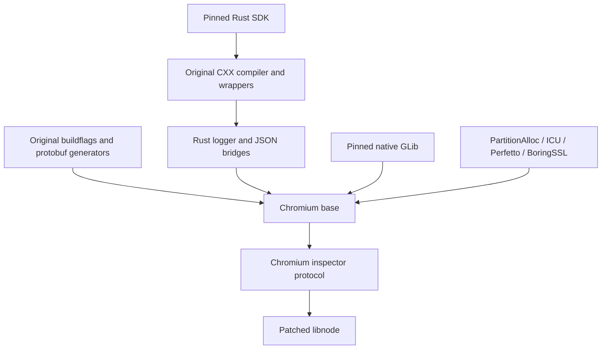

`electron_base_sources` projects declared files read-only. Generated build dates
use the captured fixed timestamp; version generation consumes declared version
files. Python generators retain isolated interpreters, empty child `PATH`,
explicit environments and path/mtime byte checks. CXX configuration comes from
the pinned target Rust compiler; the CXX executable uses the execution platform.
Cargo does not resolve dependencies. The combined Temporal/base closure contains
85 Rust targets from 65 vendored packages; existing Temporal crates stay shared.

The linked probe exercises original Rust JSON parsing, strict/malformed input
rejection, JSON serialization, Base64 and native GLib task/idle dispatch.
[4746f81 components](https://formatjs.buildbuddy.io/invocation/88a49452-4b2d-4562-b922-e1cd177016cb),
[consumer](https://formatjs.buildbuddy.io/invocation/37a9576f-eea3-4c65-8205-6dabc9b3426e)
and [cross-compile](https://formatjs.buildbuddy.io/invocation/56160928-3964-45f8-9578-6cd78f14d964)
checks passed. Base itself remains Linux AMD64; the cross check covers existing
platform probes. Complete libnode and Electron linking remain separate work.

Base also links PartitionAlloc's original two-unit `raw_ptr` implementation.
This is distinct from its 66-unit allocator/shim closure. Its private headers
stay separate from the existing allocator header target, keeping the full V8
engine's action inputs unchanged during this extension.

## Patched libnode and native inspector

`electron_libnode_sources` translates the 171-unit patched libnode source set,
original Chromium inspector protocol implementation and matching Brotli/Zstd
libraries: 239 C/C++/assembly units total. Existing V8, Base, ICU, BoringSSL,
libuv, eleven Node dependencies and both JS2C outputs stay shared.

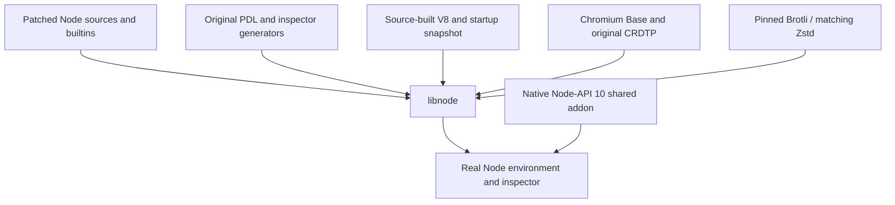

Native actions declare the PDL files read by Node's actual inspector config,
including a read-only alias to the matching patched V8 PDL. They also declare
the original generator's imported `Runtime.h`, omitted from captured GN outputs.
Zstd compression is an explicit extra native dependency: Node 22.20 exposes
compression APIs, while the captured GN edge only names the decoder. The
profile preserves original GN outputs/dependencies alongside these additions.
Zstd uses Chromium's exact `89d685e` DEPS revision and an integrity-pinned archive.
No stock Node/V8 source tree substitutes for Electron's selected versions.

Generators retain isolated Python, declared Jinja/MarkupSafe sources, empty
child `PATH`, explicit environments and output equality across paths/mtimes.
Compression header groups stay separate from Node headers; static-library and
source-set linkage retain their original distinction. Legacy GNU `-latomic`
resolves to the declared LLVM compiler-rt builtins archive, whose source includes
the atomic implementation. A native `cc_shared_library` builds the
addon; a declared pinned-Python action materializes unchanged bytes in a regular
`.node` file. Symlinking a `.so` is insufficient: Node resolves the real filename
before selecting its loader. Bazel 9 rejects a direct `.node` shared-library
filename, so the final file requires its own declared action.

`node_embed_lifecycle.patch` updates the owned `CommonEnvironmentSetup` copy to
dispose its isolate before unregistering the platform, matching Electron's
existing `NodeMainInstance` ordering. V8 can still request foreground tasks
during disposal. Original parent sources remain unchanged;
`native_compat_patches.json` records this compatibility patch.

The embedding probe initializes an actual Node environment with generated V8
startup data. It checks ABI 140, Node-API 10 shared-addon loading, original-fs,
asynchronous filesystem reads, crypto, Brotli/Zstd round trips and corruption
rejection, in-memory SQLite and inspector `Runtime.evaluate`. Generic 24-byte
atomic compare-exchange/load exercises the actual compiler-rt implementation.
[40b2baf components](https://formatjs.buildbuddy.io/invocation/db60fdd2-5715-468b-aad5-05013a89fa46),
[consumer](https://formatjs.buildbuddy.io/invocation/257b7fb2-b546-4a98-8b6a-6e1cfb45fa73)
and [cross-compile](https://formatjs.buildbuddy.io/invocation/3e5b2b22-6b6f-4636-b582-5bc4efd1af57)
checks passed. libnode itself remains Linux AMD64; cross checks still cover the
existing platform probes. A complete Electron executable and the other full
source profiles remain unfinished.

## Gin and Base i18n

`electron_embedder_sources` adds the matching 32-unit Gin library, 20-unit Base
i18n library and four-unit CED library. Base, V8, ICU, Abseil and native GLib stay
shared. CED matches Chromium's exact `ba412eaa` DEPS revision and the independently
pinned archive used by `formatjs/chromium`.

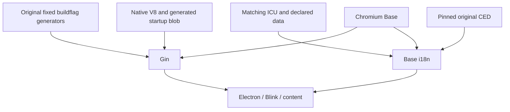

Header groups remain separate; adding embedder sources does not change existing
Base/V8 headers or compiler inputs. Buildflag generators retain explicit inputs,
isolated Python and path/mtime byte checks. Captured context-snapshot and sandbox
flags remain enabled. The utility-isolate probe loads the generated default V8
snapshot; creating Blink's additional-context snapshot remains separate work.

The probe exercises original ICU descriptor initialization, Unicode folding,
legacy conversion, malformed UTF-8 rejection, word/grapheme boundaries and CED
detection. It creates a real Gin isolate/context, installs a C++ callback, checks
JS argument rejection and UTF-8 conversion, allocates through Gin's sandboxed
ArrayBuffer allocator and verifies the binding after GC and during shutdown.
The probe passes declared files through Base/Gin's file APIs; Gin's filename API
expects an asset basename. No host asset search path is needed.
[5bca689 components](https://formatjs.buildbuddy.io/invocation/fa47e627-5c1f-48a3-bba0-a3242d1f8dc6),
[consumer](https://formatjs.buildbuddy.io/invocation/93435deb-d75a-4138-a291-8f1c2c115443)
and [cross-compile](https://formatjs.buildbuddy.io/invocation/f22772db-5323-4a1d-95be-d497d50030c6)
checks passed. This full profile remains Linux AMD64; full Electron still needs
linking.

## IPCz

`electron_ipcz_sources` builds all five captured Chromium IPCz source sets: 36
original C++ units, matching Chromium Base and shared Abseil. Source sets retain
whole-archive linkage; `IPCZ_STANDALONE` stays absent. Files project read-only
from Electron's exact Chromium archive. No independent IPCz checkout or
standalone support implementation substitutes for that configuration.

The integration probe builds four original synchronous reference-driver units
for testing only. Broker/client nodes exchange a 65,537-byte binary payload,
preserve required size after insufficient receive capacity, transfer a portal,
communicate through that portal and report peer closure. Invalid API/handle
calls and cleanup are checked too.
[c961819 components](https://formatjs.buildbuddy.io/invocation/f6a3b332-0992-416c-9457-6c23dbbb6324),
[consumer](https://formatjs.buildbuddy.io/invocation/3afbac9c-cb0e-4445-a246-0b6d499ffcde)
and [cross-compile](https://formatjs.buildbuddy.io/invocation/99392287-c350-44ac-997e-d3e17c87b1e9)
checks passed. This full profile remains Linux AMD64. Mojo/network integration
follows below.

## Mojo and networking

`electron_network_sources` translates the complete captured Mojo embedder
closure: 1,124 C/C++ units in 63 library/group/tool targets, plus 29 original
generator runs. Existing Base, ICU, IPCz, Protobuf, compression and tracing
targets stay shared. QUICHE and RE2 use Chromium's exact DEPS revisions; SQLite
uses Electron's patched source, original shim and symbol-renaming headers.
Source-listed headers, public headers and included compiler inputs stay declared.
Native NSS/NSPR build rules come from pinned
`formatjs/chromium` commit `4a2321d`. GSSAPI headers use the matching pinned
Chromium sysroot archive; product libraries never fall back to host packages.
All 34 PKI sources match the captured BoringSSL target and join its existing
SSL/crypto libraries. Net's shared type headers declare their Mojo tag,
unexportable-key and time-tracker header dependencies explicitly. The tag-only
target exposes one header instead of the complete Mojo header inventory.

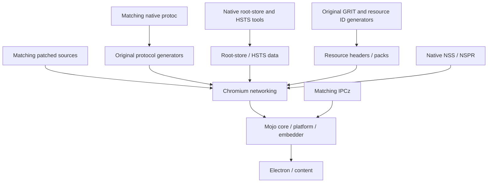

Python generators retain explicit inputs, execution-platform tools, empty child
`PATH` and byte equality across changed paths/mtimes. Two owned GRIT adaptations
make `.pak.info` source paths and the resource-ID header comment relative.
`native_compat_patches.json` records them; parent Chromium files stay unchanged.

NSS module `.chk` files use original DSA-2048 parameters, a public build key and
[RFC 6979](https://www.rfc-editor.org/rfc/rfc6979#section-3.2) SHA-256 nonces.
Original source-built NSS performs key construction, signing and verification;
its random blinding stays enabled. Each integrity action compares output bytes
across paths/mtimes. Public-key metadata inside `.chk` serves module integrity;
release signing has its own interface. Runtime random generation remains original.
Published DSA-2048/SHA-256 vectors check nonce generation.

The runtime probe loads the declared NSS implementation and calls its original
`BLAPI_SHVerifyFile` vector entry. It accepts generated and relocated integrity
files, then rejects changed library bytes and changed signature bytes. HSTS
lookup checks both sides of Chromium's 70-day build-age boundary with a scoped
test clock; production clock and expiry policy remain unchanged.

The runtime probe covers generated suffix/HSTS data, IDNA canonicalization,
invalid URLs, hashing, NSS random generation and Chromium SQL. Mojo checks binary
messages, empty/closed pipes, data pipes, shared mappings and cleanup.
[122f977 components](https://formatjs.buildbuddy.io/invocation/c4852e98-f478-4d62-9b46-d8e782e1ff68),
[consumer](https://formatjs.buildbuddy.io/invocation/376c61c9-c0a3-471b-b9a7-2d07d498f510)
and [cross-compile](https://formatjs.buildbuddy.io/invocation/2b651fc7-4805-4297-8279-0e494a51e15f)
checks passed, including the nonce vectors and fresh network-denial gate. This
full profile remains Linux AMD64. Typed bindings follow below; Blink/content
and the full Electron executable remain unfinished.


## Typed Mojo bindings

`electron_mojo_sources` adds 214 captured C++ units, 29 original Python actions
and four literal GN metadata targets. The actions produce 694 declared files:
parsed Mojom modules, precompiled templates, type mappings, message IDs and C++
bindings. Original response files, build metadata and typemap configurations
remain declared inputs. Every generator compares bytes across changed paths and
mtimes with an empty child `PATH`.

The roots are Mojo C++ bindings, Mojo base types and service-manager interfaces.
Existing native Base, IPCz, networking and compression stay shared. The 345
original Mojo headers reuse the network repository's file identity; they are
not projected again. Both captures use the same native compiler-settings helper;
recapturing networking preserves its profile bytes.

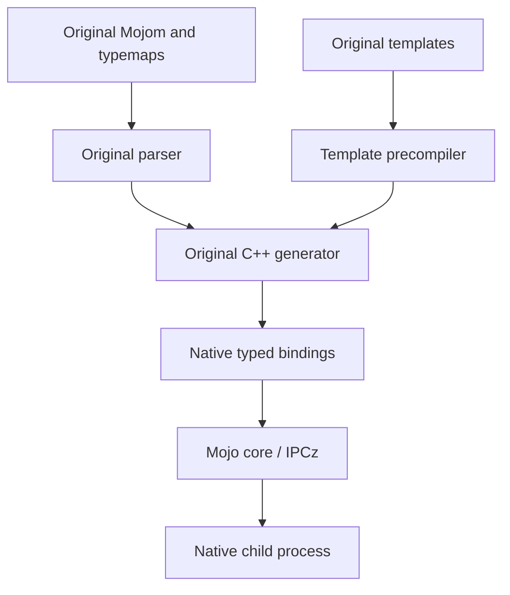

`//source:mojo_test` launches itself through Chromium's platform channel and
Mojo invitations. It checks a 65,537-byte binary message, a transferred shared
buffer with cross-process coherence, generated `InterfaceProvider` dispatch,
embedded-NUL strings, a transferred reply pipe, clean child exit and malformed
message rejection. It also checks message/data pipes and invalid-handle errors.
No replacement transport or generated-code stubs participate.

[8261fc4 components](https://formatjs.buildbuddy.io/invocation/7616e6df-a464-4d31-9870-8675906e3d6c),
[consumer](https://formatjs.buildbuddy.io/invocation/9a5dbde4-c22d-47b1-a9b9-c86ec8564d44)
and [cross-compile](https://formatjs.buildbuddy.io/invocation/a503d8d2-6a4a-466c-82c0-7c78eb528c8d)
checks passed. This complete typed profile and runtime probe remain Linux AMD64;
the cross-compile check covers existing platform probes, not complete typed
bindings on every target. Full Electron linking remains unfinished.


## Native font and XML dependencies

`electron_fonts_sources` builds all 142 C/C++ units in the captured FreeType,
HarfBuzz, libpng and libxml roots. Five native library/group targets retain
original compiler settings, Chromium's FreeType modules/options, included C
implementation files and source/public headers. Existing ICU and zlib remain
shared. FreeType and HarfBuzz use exact Chromium DEPS commits and checksum-pinned
GitHub archives. All 959 external source inputs match the original Gitiles
checkout bytes; Gitiles archives themselves changed compressed bytes between
fetches and are not used as pinned downloads.

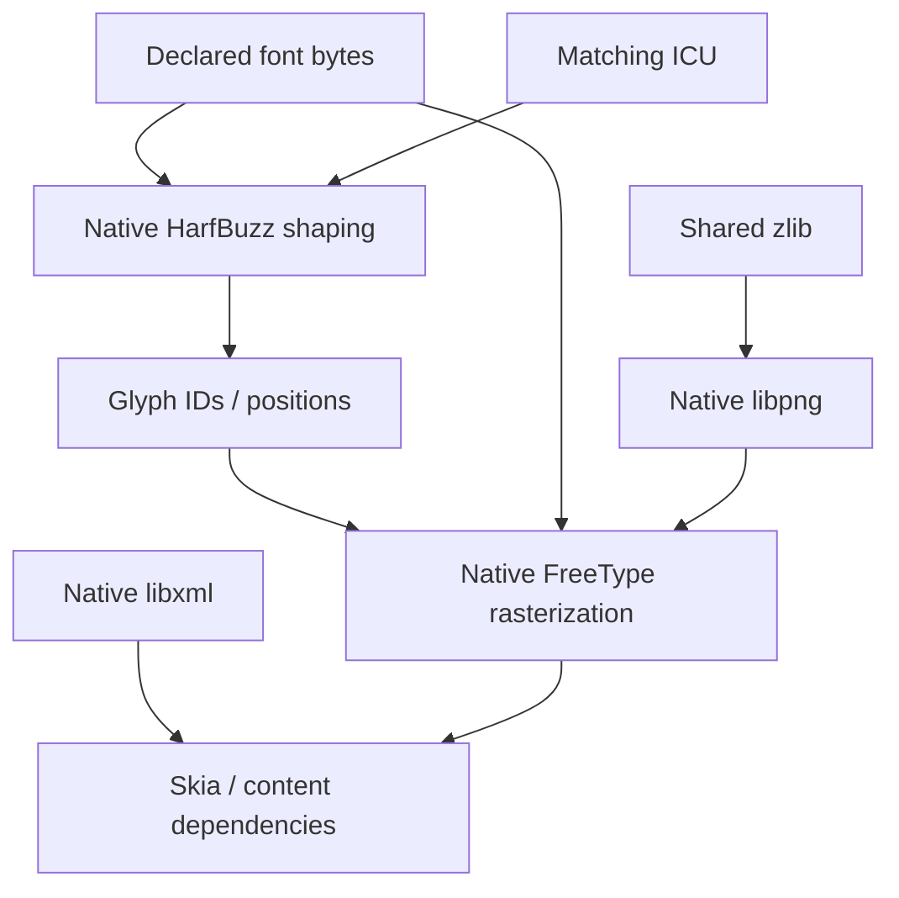

`//source:fonts_test` checks original HarfBuzz fixture advances for `ffi` with
ligatures enabled and disabled, then rasterizes the shaped ligature with
FreeType and checks nonempty pixels. It also rejects invalid font bytes, checks
a two-by-two RGBA PNG memory roundtrip (including alpha), rejects an invalid PNG
signature, parses UTF-8 XML/entity content, evaluates XPath and rejects malformed
XML. ICU data and the 6,404-byte original font fixture are declared runfiles;
no host font lookup participates.

[854f6a7 components](https://formatjs.buildbuddy.io/invocation/de381a35-b6b8-46cf-b868-6f1b830dc130),
[consumer](https://formatjs.buildbuddy.io/invocation/be89e67e-3a77-4364-917e-c8cd913427de)
and [cross-compile](https://formatjs.buildbuddy.io/invocation/cac878c2-42ac-4798-a252-b1fae8de5225)
checks passed. These complete dependency roots remain Linux AMD64. Fontconfig
and Rust fontations follow below. Complete Skia, Blink/content and Electron
linking remain unfinished; existing cross probes do not establish complete
rendering support on every target.


## Fontconfig and Rust fontations

The native font closure now includes all 29 captured Fontconfig C units, with
its original `ENABLE_FONTATIONS` setting and native BCR `libuuid` 2.41.2.bcr.1.
Fontconfig source uses DEPS commit `f0ed9c3f43161d3555f6f7a5234b22fe7ca60727`
and a SHA-256-pinned archive. The full native font/XML closure totals 171 units.

The existing Rust profile adds nine library/proc-macro targets and one original
libc build script. It now has 95 targets from 71 vendored packages. All previous
85 Rust records and previous font-library records remain unchanged. Native
bindgen generates the two original C-header boundaries; Chromium's original
`build/rust/bindings.rs` namespace wrapper stays in use. Binding filters and
C parsing settings retain the original Fontconfig configuration. The capture
records and checks its `BUILD.gn` source hash, including the bindgen-only
visibility, threading and flexible-array settings. Pinned Rust tools and the
existing allocator/prelude remain shared; Cargo never resolves dependencies.

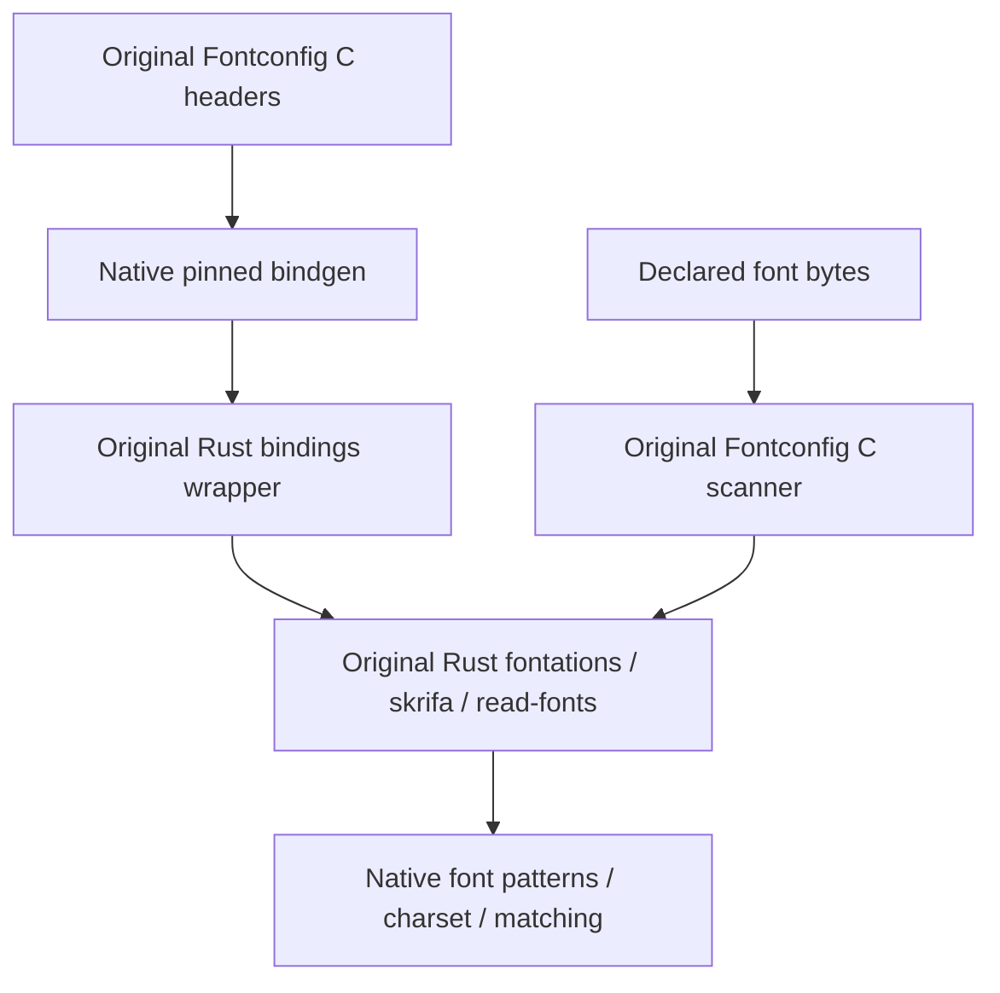

The native probe selects Fontconfig's original fontations scanner through
`FC_FONTATIONS=1`. An explicit empty configuration starts without system fonts,
loads only the declared font, checks its family, file identity and character
coverage, then matches it through the native C API. A malformed font file must
be rejected without changing the inventory; clearing application fonts must
leave it empty. The earlier shaping/raster/PNG/XML probes remain included.

[6652729 components](https://formatjs.buildbuddy.io/invocation/3a1191a5-391b-4f00-b679-ceee2aaf82f0),
[consumer](https://formatjs.buildbuddy.io/invocation/d79263f3-c960-4981-acad-338cd9b5d328)
and [cross-compile](https://formatjs.buildbuddy.io/invocation/497602af-9588-4fa5-80e6-2ba8096d5835)
checks passed. Metadata action audit found no CMake or foreign-cc actions.
This complete source profile remains Linux AMD64; full Skia, Blink/content,
other full source profiles and Electron linking remain unfinished.


## JPEG, WebP, GIF and native NASM

`electron_codecs_sources` translates all 213 C units in the captured JPEG, WebP
and Wuffs GIF roots. JPEG keeps its 27 original SIMD assembly runs and original
NASM 2.17rc0, built from all 81 captured tool C units on the execution platform.
The profile contains 26 library/group/tool targets plus the original foreach
action. Every assembly run retains `--reproducible` and compares object bytes
across changed paths and input mtimes. Original included C files, source/public
headers, SIMD inputs, compiler flags and dependency edges remain declared.

JPEG and NASM use exact Chromium fork commits `e14cbfaa85529d47f9f55b0f104a579c1061f9ad`
and `e2c93c34982b286b27ce8b56dd7159e0b90869a2` through pinned Git fetches.
WebP and Wuffs use exact DEPS commits with checksum-pinned GitHub archives.
No host NASM lookup, CMake or foreign-cc action participates. The product archive
aggregate excludes a second target-platform NASM build; assembly actions request
the tool through the execution configuration.

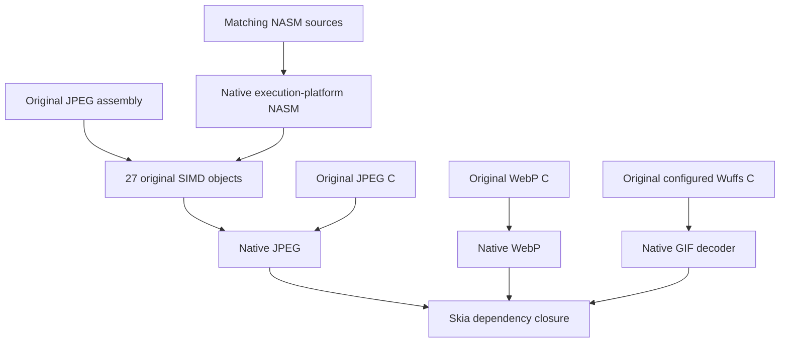

The runtime probe requires JPEG SIMD dispatch and checks a real 32-by-32 RGB
encode/decode against bounded lossy color error. WebP checks exact lossless RGBA
bytes, including alpha, and invalid-stream rejection. Wuffs decodes an opaque
one-pixel GIF through its original image/frame/pixel APIs, checks the pixel and
end-of-animation result, then rejects a changed signature. Original native codec
implementations perform every operation.

[a4c1c6a components](https://formatjs.buildbuddy.io/invocation/ac78fd37-9f01-475d-8bb5-449482a50752),
[consumer](https://formatjs.buildbuddy.io/invocation/3539d526-2758-4b59-8fc0-06b5fc20d11f)
and [cross-compile](https://formatjs.buildbuddy.io/invocation/534b1402-47d9-4822-b0a5-c9f02074a26d)
checks passed. This full codec profile remains Linux AMD64; the cross check
covers existing platform probes. Complete Skia, Blink/content, other full source
profiles and the Electron executable remain unfinished.


## Complete matching Skia closure

`electron_skia_sources` translates the complete captured `//skia:skia` closure:
1,158 C++ units in 27 library/group targets and 15 original Python actions with
25 declared outputs. Existing Base, fonts, codecs, ICU, compression and tracing
stay shared. Skia, Dawn and Vulkan headers use exact DEPS revisions with SHA-256
archive pins. Native BCR Expat supplies the captured system-library dependency;
X11/XCB/GL/EGL headers come from the already pinned matching Chromium sysroot.
No CMake or foreign-cc actions participate.

The shared Rust profile adds 12 targets, including original PNG/fontations
bridges and a crc32fast build script. It now has 107 targets from 80 vendored
packages. All previous 95 Rust target records remain unchanged. Native CXX
uses the existing pinned executable and target-compiler configuration; original
Rust and C++ bridge sources remain intact.

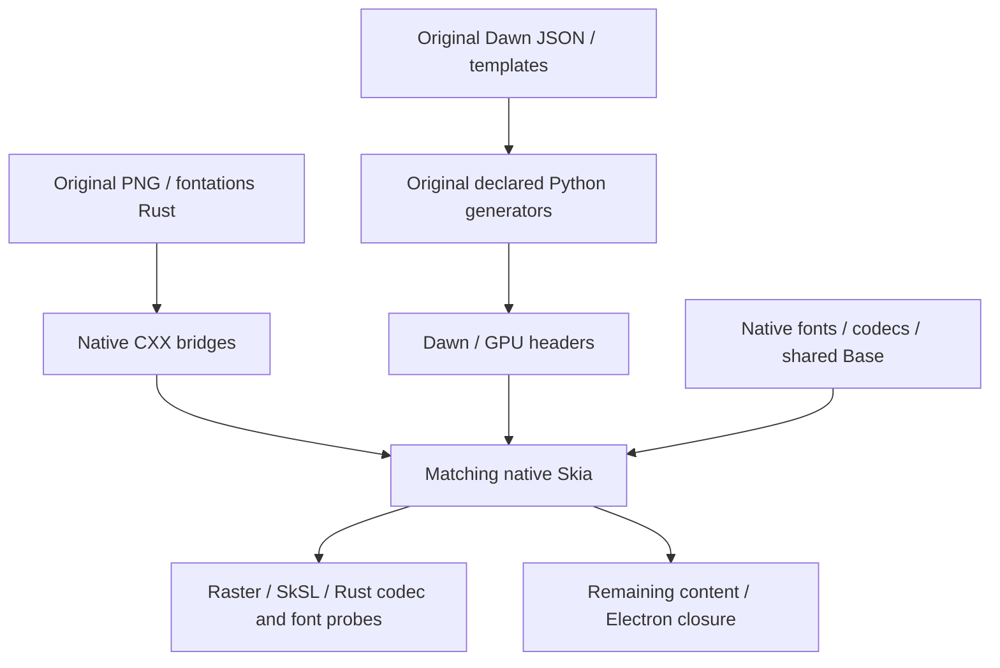

Generators retain empty child `PATH`, declared files/tools and byte equality
across changed paths and mtimes. Dawn's expected-output lists derive from its
captured extractor outputs, matching the original `generator_lib.gni` declaration;
source hashes record that derivation. Original output-list validation stays
active. `gpu/webgpu/DAWN_VERSION` is a declared 40-byte pinned Dawn revision,
so archive builds do not depend on a checkout hook or ambient Git execution.

PartitionAlloc's `raw_ptr` provider now exports its complete original pointer
header family and transitive includes: 62 headers, with existing allocator code
and configuration unchanged. Wuffs exports its original `src/release/c` public
include directory. Consumers use these shared providers rather than copied
headers or replacement APIs.

The runtime probe checks every pixel of a rasterized SkSL shader and rejects an
invalid shader. Original Rust PNG encoding/decoding must preserve RGBA bytes and
alpha, then reject invalid input. Original Skia fontations loads the declared
font, maps a glyph and returns a nonempty path through its Rust/CXX path bridge;
invalid font bytes must fail. ICU and font data remain declared runfiles.

[3d7a5d1 components](https://formatjs.buildbuddy.io/invocation/3c7c227a-8327-422d-8c40-7509a4ff575f),
[consumer](https://formatjs.buildbuddy.io/invocation/eb13ad3b-8467-451d-8ff5-41aaafca7a66)
and [cross-compile](https://formatjs.buildbuddy.io/invocation/dc1a8ae4-65ef-4469-ae39-52f89c00efd8)
checks passed. This complete Skia profile remains Linux AMD64; runtime coverage
uses CPU raster/SkSL, not a hardware GPU context. Existing cross probes do not
establish complete Skia support on other targets. Blink/content, other full
source profiles and the Electron executable remain unfinished.

## Native graphics closure

`electron_gfx_sources` captures `ui/gfx`, image codecs, memory buffers, data packs
and geometry/range Mojo bindings. It adds 351 native C/C++/assembly units in
62 library/group targets, 34 original Python actions and four literal GN metadata
targets. Existing Skia, Mojo, fonts, codecs and Base providers stay shared.

libdrm and libsync use exact Chromium DEPS commits. Crashpad comes from the
Electron-patched Chromium tree. The original libdrm configuration group retains
its native dependency; no system library discovery or wrapper build substitutes
for these sources. Original generators retain declared inputs, empty child PATH
and changed-path/mtime byte checks.

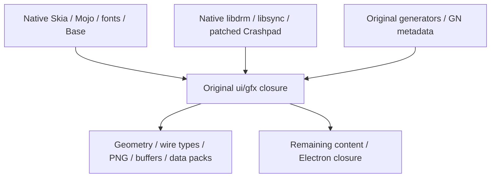

`gfx_test` covers transform composition/inversion, singular rejection, native
geometry/range wire roundtrips and truncated wire rejection, PNG RGBA/alpha and
invalid input, NV12 layout and size overflow, original DRM format/modifier names,
and deterministic binary data packs with duplicate resources and truncated-input
rejection. This captured profile remains Linux AMD64. Hardware GPU/device and
Crashpad process execution need separate runtime coverage.

Recapture from matching public checkouts:

```sh
python3 tools/capture_gfx.py \
  --graph=bcr/overlay/source/native/linux_amd64.partial.json.gz \
  --chromium-root=/path/to/electron-patched-chromium \
  --libdrm-root=/path/to/libdrm-ad78bb591d02162d3b90890aa4d0a238b2a37cde \
  --libsync-root=/path/to/libsync-f4f4387b6bf2387efbcfd1453af4892e8982faf6 \
  --profiles=bcr/overlay/source/native \
  --output=bcr/overlay/source/native/gfx_inputs.json
```

[8f46f43 components](https://formatjs.buildbuddy.io/invocation/064306e7-598c-4ec4-9fb2-1e55f172e442),
[consumer](https://formatjs.buildbuddy.io/invocation/e3112348-39f6-47a5-8001-f72d63c0f457)
and [cross-compile](https://formatjs.buildbuddy.io/invocation/e1c6f98a-f21f-430b-9a5e-2b1206b25deb)
checks passed, including the real gfx runtime probe. Original cc component
headers and Crashpad's assembly include are declared source inputs. Skia
recapture remains byte-identical after sharing the profile ownership loader.
Action analysis found no CMake or foreign-cc actions. Full Electron remains
unlinked; existing cross probes cover their named platform boundaries.

## Native display closure

`electron_display_sources` translates the complete captured `ui/display:display`
and `ui/display/mojom:mojom` roots: 118 native units in 22 library/group targets,
21 original Python actions and three literal GN metadata targets. Existing
gfx/Skia/Mojo/Base providers retain their source and target identities. Chromium
provides device event logging, EDID parsing, native display models and the full
display/gfx Mojo traits. No new upstream source revision is introduced.

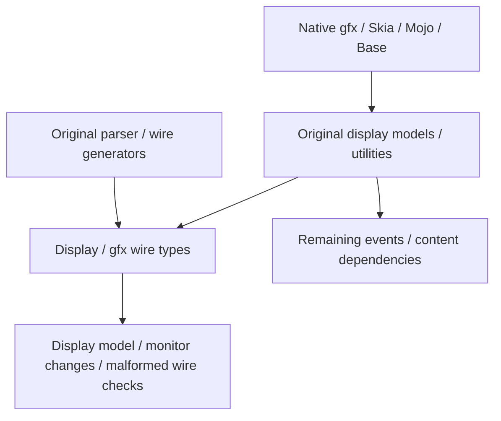

`display_test` checks native/logical coordinates, work-area insets after scaling
and relocation, monitor enumeration/change/removal notifications, primary-display
changes and display wire roundtrips. Original ScreenInfos deserialization must
reject empty lists, duplicate IDs and missing selected IDs. Test models use
explicit values; no host display discovery participates. Generator children use
`-s -P` with an explicit environment and `PYTHONHASHSEED=0`: `-I` would ignore
the seed. Empty PATH, disabled user site/current-directory imports and
changed-path/mtime output checks remain active. The shared Mojo projection patches
only parser diagnostic filenames to source-relative paths; compound `EnableIf`
AST nodes retain those names in pickles. Feature evaluation and generated wire
semantics remain original. Physical display/GPU
execution remains separate coverage. Full profiles remain Linux AMD64.

Recapture from the matching Electron-patched Chromium checkout:

```sh
python3 tools/capture_display.py \
  --graph=bcr/overlay/source/native/linux_amd64.partial.json.gz \
  --chromium-root=/path/to/electron-patched-chromium \
  --profiles=bcr/overlay/source/native \
  --output=bcr/overlay/source/native/display_inputs.json
```

[81686a0 components](https://formatjs.buildbuddy.io/invocation/5469ba93-723a-442d-9f7c-1aee47571ecc),
[consumer](https://formatjs.buildbuddy.io/invocation/8c32e657-744a-4257-b51d-53ba5f139a24)
and [cross-compile](https://formatjs.buildbuddy.io/invocation/7c3d5002-aee4-478a-bc66-fb38212ed06e)
checks passed. The display runtime probe and existing source runtime suite passed.
Action analysis found no CMake or foreign-cc actions. Complete Blink/content,
other full source profiles and the Electron executable remain unfinished.

## Native events closure

`electron_events_sources` captures the complete `ui/events:events` dependency
closure: 417 native units in 125 library/group targets, 76 original Python
actions, seven literal GN metadata targets and one original protocol-copy step.
Existing display/gfx/Skia/Mojo/Base/Perfetto/Protobuf providers retain their
identities. Matching Snappy comes from its exact Chromium DEPS commit; the
existing pinned JavaScript protoc plugin remains an execution tool.

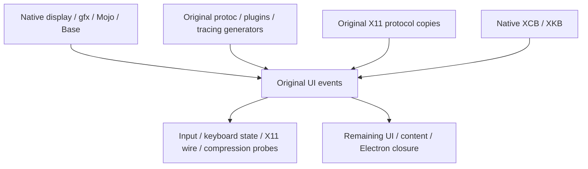

Native XCB uses pinned BCR libxcb/xcb-proto sources with declared Python
generation and byte checks across changed paths/mtimes. Original shell moves
and header copies become declared copy actions. Linux abstract sockets stay
enabled, matching the Chromium reference. Native libxau and xkbcommon retain
their BCR source rules; no CMake/foreign-cc wrappers participate.

The runtime probe uses explicit input events, an inline XKB keymap with default
includes/environment names disabled, a fixed X11 keyboard packet and binary
Snappy data. It checks modifier/clone and transform behavior, shift press/release,
invalid keyboard layout rejection, original X11 decoding, XCB display parsing
and compression/truncation handling. No host keyboard layout or X server is
required. This complete source profile remains Linux AMD64; physical X11/device
execution and other full source profiles need separate coverage.

Recapture from matching public source checkouts:

```sh
python3 tools/capture_events.py \
  --graph=bcr/overlay/source/native/linux_amd64.partial.json.gz \
  --chromium-root=/path/to/electron-patched-chromium \
  --snappy-root=/path/to/snappy-32ded457c0b1fe78ceb8397632c416568d6714a0 \
  --protobuf-javascript-root=/path/to/protobuf-javascript-e6d763860001ba1a76a63adcff5efb12b1c96024 \
  --perfetto-root=/path/to/electron-patched-perfetto \
  --profiles=bcr/overlay/source/native \
  --output=bcr/overlay/source/native/events_inputs.json
```

[decd4f5 components](https://formatjs.buildbuddy.io/invocation/69a9e5a2-7f52-4b5e-9019-e668a8c35dd3),
[consumer](https://formatjs.buildbuddy.io/invocation/eafe398a-4731-4923-94ce-1b34ab04fa1f)
and [cross-compile](https://formatjs.buildbuddy.io/invocation/93ec6252-8c42-4cef-9b6d-50def569b0e3)
checks passed. Original X11 keysym headers and three textually included keyboard
C implementations are declared inputs. The wire probe uses public decoding and
owned-memory interfaces. Generator byte checks remain enabled. Complete
Blink/content, other full source profiles and the Electron executable remain
unfinished.

## Native UI and WebUI closure

`electron_ui_sources` captures the complete `ui/base:base` dependency closure:
96 native units in 76 library/group targets, 339 original Python actions,
24 literal GN metadata targets and 15 original copy steps. Existing native
events/display/gfx/Skia/Mojo/Base providers retain their identities. Original
TypeScript, ESLint, preprocessing, minification and GRIT producers remain in the
action graph; explicit ordering dependencies retain validator steps.

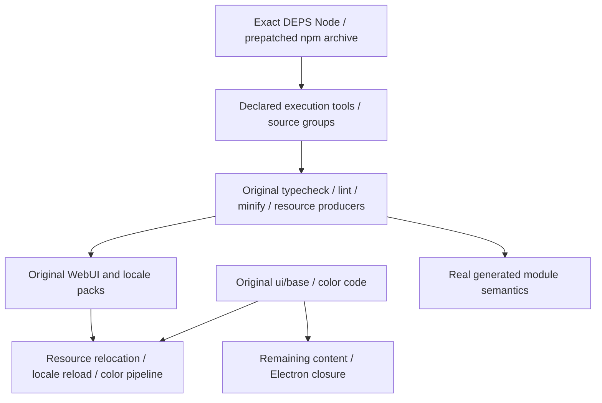

Chromium's DEPS supplies checksum/generation-pinned WebUI tool sources and Node
22.11.0 for execution. This bootstrap is separate from Electron's Node 22.20.0
webpack toolchain and embedded target Node. No package install hooks run. Shared
canonical source groups retain each declared npm file without repeating npm
file lists in each action. Directory-based tools receive generated outputs and
source inputs from their original GN predecessor actions. TypeScript dependency
configurations retain their original declaration files. GRD manifest inputs
also declare the original static HTML, SVG, font and third-party resource bytes.
Captures reproduce across Python hash seeds. Child PATH remains empty; original
generators retain changed-path/mtime byte equality.

The native probe relocates actual English/French packs, selects each locale with
an explicit `LANGUAGE` value for Linux GLib, reloads locale strings,
compares packed WebUI module bytes with original minifier output and checks
layered native color aliases/postprocessing. A separate probe executes the real
compiled/minified color module with the pinned Node tool, including invalid-input
handling. Full source profiles remain Linux AMD64; complete Blink/content and
the Electron executable remain unfinished.

[2b46400 components](https://formatjs.buildbuddy.io/invocation/589e4e60-43b7-410f-b0c4-afd40ab9c125),
[BCR consumer](https://formatjs.buildbuddy.io/invocation/c1ddb72f-d5fb-446f-8cb4-ea7e8e39da31)
and [cross-compile](https://formatjs.buildbuddy.io/invocation/5dfdee24-4f76-42b3-94ef-77682b793feb)
checks passed. No CMake/foreign-cc actions matched the UI
action audit. The public tool archive is consumed as pinned sources without
package installation or host Node discovery.

Reproduce source capture with the matching patched Chromium tree and extracted
DEPS npm source archive:

```sh
python3 tools/capture_ui.py \
  --graph=bcr/overlay/source/native/linux_amd64.partial.json.gz \
  --chromium-root=/path/to/electron-patched-chromium \
  --node-modules-root=/path/to/pinned-node_modules \
  --profiles=bcr/overlay/source/native \
  --output=bcr/overlay/source/native/ui_inputs.json
```

## Native Ozone/GL integration

The validated `e677b62` Ozone/GL baseline contains:
2,147 native units in 306 library/group/runtime targets, 116 original generator
targets (117 runs), eight GN metadata targets and two literal Dawn output lists.
Fifteen source repositories retain the exact Chromium/Dawn DEPS revisions.
Existing native UI, Skia, Mojo, Rust and Base providers retain their identities.

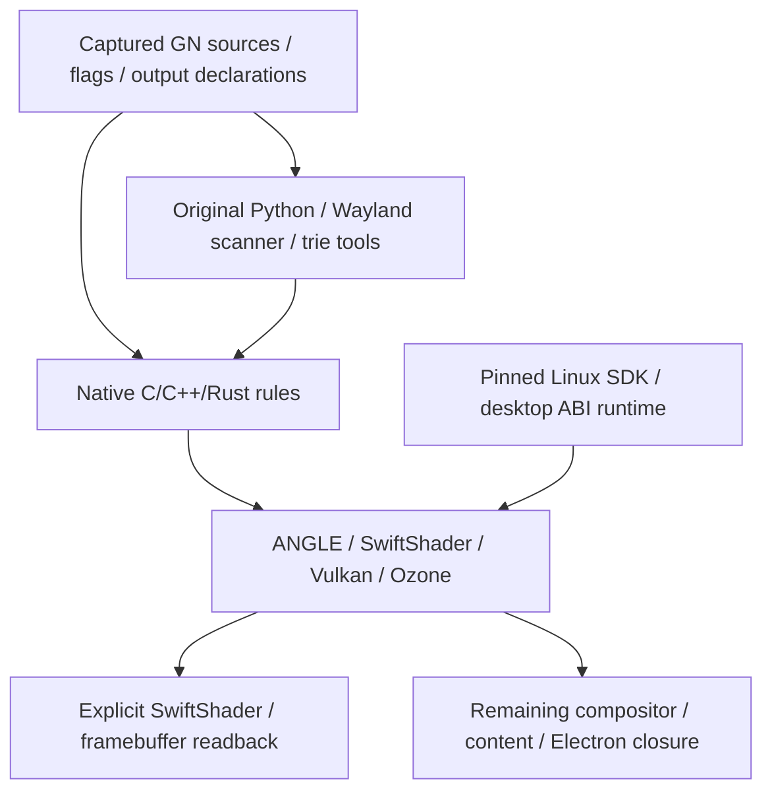

Shared-library version scripts, SONAMEs and ICD manifests remain declared
products. C/assembly members of shared targets link eagerly, matching their C++
objects. The Vulkan loader is entirely C; lazy archive groups discarded its API
exports. A real loader export/dispatch test reproduces that failure before the
link fix. Header providers forward compilation context without adding code to
unrelated DSOs. Rust FFI crates depend directly on their native C++ owners.

Native GLib, GObject, GModule, GIO and zlib have shared outputs with their original
SONAMEs. This gives their initialization and allocator state one owner across
EGL/GLES libraries and the consumer. Desktop ABI data remains 53 declared files
from 49 checksum-pinned Debian packages matching the Chromium SDK; the native
outputs take priority over the five corresponding SDK files. These SDK inputs
are not source-built library claims.

Native Rust providers supply standard-library inputs instead of GN's relative
archive paths. The Wayland scanner consumes Chromium's checked-in Linux
configuration header. Compilation headers stay independent of generated protocol
headers. Original generator validators and changed-path/mtime byte checks remain
enabled, including Dawn's expected-output declarations. The native trie generator
keeps its original C++ executable provider, with ICU data beside its binary in
the execution configuration. PCIutils, Wayland, ANGLE, SwiftShader and the Vulkan
loader compile from source. Execution Node and Electron's embedded Node remain
separate.

The graphics probe loads the actual Vulkan/EGL/GLES libraries, checks the loader
API, explicitly selects SwiftShader, renders a 2×2 framebuffer and checks every
RGBA byte. Loader paths contain declared source/runtime files; optional Vulkan
layers are disabled and caches use test scratch space. Graphics runs first in
source CI; the complete aggregate and suite remain required afterward.

[e42592d components](https://formatjs.buildbuddy.io/invocation/9a591f26-aab9-495f-8a05-da63df40d687),
[BCR consumer](https://formatjs.buildbuddy.io/invocation/44781263-425a-4713-a6e2-288114a29449)
and [cross probes](https://formatjs.buildbuddy.io/invocation/2a544517-a493-4bd2-9e08-ac3beb1bee52)
passed. Temporary crash instrumentation is removed. The clean
[e677b62 components](https://formatjs.buildbuddy.io/invocation/7056db57-2403-44a5-ac43-048b82fa95ec),
[consumer](https://formatjs.buildbuddy.io/invocation/0109ff8b-c8e5-4faf-9cda-c333de0a4be3)
and [cross probes](https://formatjs.buildbuddy.io/invocation/eb37a769-f425-4ba9-9c64-5f77a864c1a2)
also passed.
Source component profiles remain Linux AMD64. Complete Electron remains
unfinished.

Source capture reads metadata only:

```sh
python3 tools/capture_platform.py \
  --graph=bcr/overlay/source/native/linux_amd64.partial.json.gz \
  --chromium-root=/path/to/electron-patched-chromium-and-deps \
  --source-root=third_party/wayland/src=/path/to/wayland-a156431ea66fe67d69c9fbba8a8ad34dabbab81c \
  --source-root=third_party/wayland-protocols/src=/path/to/wayland-protocols-efbc060534be948b63e1f395d69b583eebba3235 \
  --source-root=third_party/wayland-protocols/kde=/path/to/kde-protocols-0b07950714b3a36c9b9f71fc025fc7783e82926e \
  --profiles=bcr/overlay/source/native \
  --output=bcr/overlay/source/native/platform_inputs.json
```

## GPU command-buffer integration

The graphics profile captures GLES2 client/service command buffers, Viz common
and GPU IPC client/host/service: 2,639 native units across 409 library/group/runtime
targets, 179 declared generator targets (180 runs), and 16 exact source pins.
Libyuv comes from its Chromium DEPS revision. GPU/Mojo/Dawn generation and the original
Protobuf wrapper retain their declared tools and outputs.

Chromium's `lastchange_dawn` checkout hook is a declared action. Its original
`lastchange.py` receives pinned Dawn revision/time through its supported environment
interface. A small import-only patch defers depot-tools loading until Git lookup
is needed. The hook runs without Git or clock discovery and keeps its original
header guard and revision format. Capture verifies the original DEPS command;
generated bytes are checked across changed source paths and mtimes.

The native protocol probe uses original command serializers, CommonDecoder,
CommandBufferService and transfer buffers. It checks token/state propagation,
shared-memory byte transfer, invalid ranges/handles, bucket limits and error
callbacks. It also exercises real GPU preference serialization, shader-cache
protobufs, Viz NV12 plane sizing and pinned libyuv ARGB-to-NV12 conversion.
Converted chroma bytes pass through the native transfer buffer and decoder.
GPU preferences use the real source-built Mojo embedder. The existing SwiftShader
pixel probe and complete source suite remain required.

[9a26e4a components](https://formatjs.buildbuddy.io/invocation/85548eee-1919-463f-b3bc-faff67712494),
[BCR consumer](https://formatjs.buildbuddy.io/invocation/7fe6e314-f4e1-48e2-a742-0f55ecf58e30)
and [cross probes](https://formatjs.buildbuddy.io/invocation/2c7580d3-ff97-41a2-a821-cdd4ce646ecb)
passed. The [complete native suite](https://formatjs.buildbuddy.io/invocation/a2205917-022b-4e00-a863-c111dae2b214)
includes the transport and real SwiftShader rendering checks. Full Electron
remains unfinished.

Quoted sibling includes keep their checked-in relative file layout across profile
boundaries. The capture projects their recursive source closure locally instead
of redirecting those files into another source repository. No compiler include
path workaround or source patch is needed.

The GPU transport launcher declares the complete pinned desktop runtime and native
shared GLib/zlib owners. Its isolated library path includes that closure before
host defaults; driver lookup points only to the declared SwiftShader manifest.

## Symphonia media dependency

Chromium's compositor depends on media, including its original Symphonia FLAC
Rust bridge. The capture now includes that exact closure: ten additional Rust
targets and nine vendored packages, preserving the existing 107 Rust targets.
Native rules run the original CXX wrapper with source-built cxxbridge and declared
target Rust configuration. The C++ boundary keeps generated headers separate
from native link owners.

The new native test decodes a complete FLAC packet through Chromium's original
CXX/Rust bridge and compares every output sample against its independent WAV
fixture. Capture verifies the WAV PCM checksum against the FLAC STREAMINFO MD5,
records source SHA-256 values and identifies the first packet by its frame CRC.
The test also checks empty packets, decoder recovery and rejected initialization.
Both fixtures come from the pinned public Chromium sources.

Metadata analysis passed without local build actions; capture bytes remain stable
across hash seeds. [bdd6d7e components](https://formatjs.buildbuddy.io/invocation/86cc1e18-00a5-4033-96eb-cb6f81f7e986),
[BCR consumer](https://formatjs.buildbuddy.io/invocation/b5e0d4f7-7a0e-43a7-9cc1-e93a4dfe85de)
and [cross probes](https://formatjs.buildbuddy.io/invocation/86f8eb41-b3fe-4e20-8731-d765a70eced7)
passed. The [complete native suite](https://formatjs.buildbuddy.io/invocation/0bb1fe8e-7bab-42eb-9eee-a3d994fa6a60)
reports Symphonia, GPU transport and SwiftShader probes as PASSED. Original CXX
generation retains its Python helper imports and checks output bytes across
changed source paths and mtimes.

This dependency remains Linux AMD64. It does not complete the compositor, media
stack or Electron executable; cross probes cover their existing contracts.

The remaining compositor closure includes media codecs, WebRTC and their original
generators. The pinned Chromium reference already has a native
[media rule implementation](https://github.com/formatjs/chromium/blob/4a2321d1086a36b4bb99ec237a379827b784b0b0/overlays/chromium/bcr/overlay/native/media.bzl)
that can guide those ports. Its Chromium 142.0.7444.59 graph cannot replace
Electron's patched 142.0.7444.52 configuration: recapture Electron flags, source
pins and generated outputs, and verify codec/provider compatibility.

## Full media source closure

The platform profile now includes `//media:media`: 1,529 additional C/C++ units
and 156 original NASM object actions. Combined graphics/GPU/media coverage is
4,324 source/object units across 493 library/group/runtime targets, 203 generator
targets (353 runs) and 27 exact source pins. FFmpeg reuses Electron's patched
source repository. Codec configurations and generated outputs come from the
Electron graph rather than the newer upstream Chromium graph.

Original stub generation and source-built NASM remain declared native Bazel
actions. Capture includes their source/header/assembly input closures and checks
output bytes across source paths and mtimes. GN macro expressions preserve their
spaces as a single compiler argument; libvpx's original allocation limit was
verified in the analyzed compile actions.

The pinned SDK now declares ALSA and Pulse headers. Its stripped ALSA link
interface and checksum-pinned real runtime retain matching symbols, symbol
versions and build identity. The runtime closure now has 54 libraries from 50
packages; these desktop ABI libraries are not source-built library claims.

New BB tests compare native FFmpeg FLAC output against the independent WAV
reference, check the original Chrome AAC/H264 decoder registry, exercise Chromium
audio parameters and check ALSA allocation/version APIs without audio hardware.
A separate ELF test verifies SDK/runtime ABI identity.

[755d607 BCR consumer](https://formatjs.buildbuddy.io/invocation/65b0f31c-7d09-4a0b-93fa-36ad204cd4e2),
[source components](https://formatjs.buildbuddy.io/invocation/459c32ae-27ea-4ac6-bf40-b3908f40ca8d)
and [cross probes](https://formatjs.buildbuddy.io/invocation/bd1165c5-db04-43b3-963e-6359254e6449)
passed. Structured results report media runtime, ALSA ABI, Symphonia, GPU transport
and SwiftShader as PASSED. The BCR source test invocation took 267.192 seconds:
1,778 tracked remote actions, 1,292.109 CPU seconds, 740,192,256 bytes maximum
action peak memory, 1,662,435,292 input bytes and 26,726,385 output bytes. These
are observed incremental CI figures, not a cold-build benchmark.

Analysis of the expanded library graph found no CMake or foreign-cc actions.
This profile remains Linux AMD64. Audio server/device integration, compositor
and full Electron remain unfinished.

## Compositor source closure

The platform profile now includes the original `//cc:cc` closure: 2,017 additional
C/C++ units, including Electron-patched WebRTC and pinned federated-compute/SRTP
sources. Combined coverage is 6,341 source/object units, 1,490 library/group/runtime
targets, 525 generator targets (675 runs) and 30 exact source pins. New generators
retain original field-trial, metrics, permissions-policy and GRIT behavior.
GRIT reuses the existing patched network-owned inputs; WebRTC header generation
does not invoke its clock-dependent expiration-report command.

Five checksum-pinned X11 packages extend the desktop runtime to 59 libraries from
55 packages. Their dynamic symbols, available symbol-version sections and build
identities match the SDK interfaces; the real runtime also supplies executable
sections. Source capture is stable across Python hash seeds. Bazel analysis of
the full library closure and runtime probe passes with zero build actions.

The runtime probe exercises layer ownership, replacement, reparenting, geometry
and opacity, then replays an actual paint record through Skia. It checks every
pixel after clipping, translation and alpha blending, plus restored canvas state.
[4a2bf7d source components](https://formatjs.buildbuddy.io/invocation/76fcec92-d070-4111-bb69-9409ad3645a0),
[BCR consumer](https://formatjs.buildbuddy.io/invocation/e094d365-9ce7-4b46-a66b-d7eb2df6f6ef)
and [cross probes](https://formatjs.buildbuddy.io/invocation/462db483-9fb6-4093-9889-cecbb0577540)
passed. Structured results report compositor, media runtime, ALSA ABI, Symphonia,
GPU transport and SwiftShader as PASSED. Existing 493 library records and 203
generator records remain unchanged. Capture declares file-valued options such as
the field-trial schema; its supported `--year=2025` option fixes the copyright
year without reading the clock. WebRTC uses declared SDK PipeWire/SPA headers.
Audio/display server integration remains untested.

The warm source aggregate took 164.160 seconds with zero tracked remote actions;
the following full source suite took 100.692 seconds, also with zero remote
actions. The BCR source suite took 301.185 seconds with two tracked actions,
4.065 CPU seconds, 356,081,664 bytes maximum action peak memory, 437,200,229 input
bytes and 9,228,165 output bytes. These are incremental CI observations, not
cold-build benchmarks; warm orchestration/cache/download time needs profiling.

This profile remains Linux AMD64; full Electron remains unfinished. The next
Blink platform closure adds 5,989 C/C++ units plus Rust crash/font-format and
CrabbyAVIF prerequisites. Its graph also requires original IDL, USB identifiers,
DevTools overlay and additional Blink generators.

## Blink Rust bridges

The Rust profile now captures Blink's original font-format and mixed-language
crash modules: two additional Rust targets, with all 117 existing records and
89 vendor package inventories unchanged. Original CXX actions use source-built
cxxbridge, declared rustc configuration and Python helpers. Generated headers
forward compilation context separately from native link owners. The crash
callback compiles its original C++ source with original flags and source-set
link semantics.

Seven pinned SFNT fixtures cover plain fonts, COLRv0/COLRv1, variable fonts,
sbix and CBDT/CBLC. Tests call every exported format predicate through CXX and
reject empty/truncated inputs; CFF2 and avar2 currently have negative cases only.
The crash probe calls the original Rust/C++/Rust chain in a child with core dumps
disabled, requiring the original panic message and SIGABRT. Crash reporting is
not covered by that check.

Capture is stable across hash seeds. Analysis of the new libraries/tests passes
with zero build actions. The complete platform/bridge dependency audit found
zero CMake/foreign-cc actions, with 20,791 CppCompile actions as a positive control.
[d158dbb components](https://formatjs.buildbuddy.io/invocation/16dbafe5-cc1e-40b8-961b-0ae8fae9d3bd),
[BCR consumer](https://formatjs.buildbuddy.io/invocation/74320089-9454-4c96-9c7e-23d9a7140085)
and [cross probes](https://formatjs.buildbuddy.io/invocation/136d9125-d6f6-4c63-a668-8e89365933b6)
passed. Structured results explicitly report both new probes as PASSED. The BCR
source suite took 39.841 seconds with 12 tracked remote actions, 2.445 CPU seconds,
395,137,024 bytes maximum action peak memory, 156,105,220 input bytes and
10,663,694 output bytes. These are incremental CI observations.

Full source profiles remain Linux AMD64; CrabbyAVIF, Blink and full Electron
remain unfinished. CrabbyAVIF's dav1d/libyuv bindings will reuse the matching
native source owners already present in the platform profile.

## CrabbyAVIF (validation pending)

The Rust profile includes Chromium's original CrabbyAVIF decoder and its dav1d/
libyuv namespace wrappers: 122 Rust targets, with all 119 earlier records and
89 vendor inventories unchanged. Source revision
`3ba05863e84fd3acb4f4af2b4545221b317a2e55` comes from Electron's Chromium DEPS.
Original features, bindgen allowlists and named generated files are retained;
Cargo build scripts are not substituted for the GN graph. Native codec symbols
and headers use the existing matching source-built dav1d/libyuv owners.

The decoder probe compares every RGB byte of the upstream lossless AVIF fixture
against its independent PNG, decoded with the existing source libpng owner.
It also checks malformed input, native codec versions, C API object lifetimes
and limited-range RGB/YUV conversion. Both fixtures have checked-in source hashes.

Analysis passes with zero build actions. Capture is stable across hash seeds.
A full source-aggregate/decoder dependency audit found zero CMake/foreign-cc
actions, with 24,493 CppCompile actions as a positive control. Hosted compilation
and runtime validation remain pending. Full source profiles remain Linux AMD64;
Blink and full Electron remain unfinished.

## CrabbyAVIF decoder

`@electron//source/crabbyavif:crabbyavif` links the original Chromium DEPS
revision through native Bazel Rust, bindgen, dav1d and libyuv targets. The
122-target Rust capture preserves all previous 119 records and 89 package
inventories. Bindgen keeps the original generated filenames and public native
configuration; no Cargo build script replaces GN metadata.

`@electron//source/crabbyavif:decode_test` decodes the pinned lossless AVIF and
compares every RGB byte against its independent upstream PNG. It also checks
malformed input, codec versions, owned RGB allocation/free and RGB-to-YUV
conversion. Like Blink, the probe parses and selects frames while the decoder
owns image planes and metadata. The pinned convenience ReadMemory API shallow
copies metadata; destroying its copied image is unsafe and is not validated.

Implementation `4cc896e` passed hosted components, BCR consumer and cross probes.
The BCR source child reports the decode probe PASSED through cleanup and
conversion. These source profiles cover Linux AMD64; this is not a complete
Electron executable or renderer integration.

## Blink generator prerequisites

`@electron_platform_sources//:blink_bindings` builds the original Web IDL
collections/database, testing IDLs and event tables, plus 17 original platform
generators for runtime features, policy declarations, settings, names and color
data. At `3888599`, this pipeline had 551 generator targets and 1,491 native
library/group records. Existing records stay unchanged; the extra group owns testing IDLs.

Color generation uses declared, source-built `@gperf//:gperf` (3.1.bcr.2). The
runner stages that executable explicitly with an empty PATH. Every generator
runs twice under different source paths and mtimes. Inputs and response files
come from the Electron-patched Chromium 142 graph.

The source aggregate builds these outputs. The source suite includes
`@electron//source/blink_bindings:bindings_test`, checking event inheritance,
component ownership, export metadata and native header directories.

Only generator headers reachable from native C/C++ owners enter the shared
compilation headers. Auxiliary testing IDLs no longer invalidate unrelated
compilation. The selected header set matches the pre-IDL native profile.
Implementation `3888599` passed hosted components, BCR consumer and cross
probes. Its aggregate profile records 26 generator actions, including native
gperf generation, and the full source suite reports the binding probe PASSED.
Full Blink platform integration is unfinished.

## Full Blink platform capture

The Linux AMD64 capture now includes original
`//third_party/blink/renderer/platform:platform` and its dependency closure:
12,256 source/object units, 2,989 native library/group targets, 1,633 generator
targets and three copy targets. Previous native library and literal metadata records remain unchanged.
Resource followups extend GRIT input declarations. Forty-nine exact source pins include the
additional ML/font dependencies; DevTools retains Electron's original patches.

DevTools uses declared Node and the SHA256-pinned esbuild package from its own
DEPS. Its npm inventory contains 24,211 files. FlatBuffers, USB IDs, search-engine
data, Mojo, resources and Unicode character data retain their original producers.
Native character generation receives declared ICU data. The JSON-to-struct CLI
patch exposes a year parameter, and capture pins it to 2025. Source projection
copies patched helpers before applying patches.

`@electron//source/blink_platform:platform_test` exercises native ICU/WTF setup,
UTF-8 validation, grapheme boundaries, string interning, Unicode properties and
generated CSS color lookup. It uses the existing isolated desktop-library
wrapper. Compile, link and runtime validation remain pending. The renderer and
full Electron executable are still unfinished.

GRIT resource inputs include descriptor references, sibling web assets, and all
checked-in layout/scale image variants. The resource fixes remain under hosted
validation.

The generated platform manifest pools repeated string lists. Bazel's exported
`PROFILE` retains its original values; metadata tools use
`tools.native_graph.unpack_profile` when reading the file. A full-data round trip
and comparison of all 76,246 registered action keys verified that pooling alone
preserves build behavior. The compact pooled file is about 26.6 MB instead of
94.7 MB. This measures stored bytes, not build speed.

### Blink core

The Linux AMD64 profile now includes the complete original
`//third_party/blink/renderer/core:core` closure: 36 additional library/group
targets, 3,863 native source/object units and 72 original generators. Source pins
and existing library/action records stay unchanged.

Core-only compilation headers have a separate provider. The base layer retains
its exact 34,134 raw headers and 1,632 generated owners; the core layer adds
3,329 raw headers and 73 generated owners. Both layers derive from the pinned GN
graph, without reading an earlier profile as configuration.

The native core probe uses the original HTML tokenizer for tag case folding,
quoted attributes, named/numeric entities, CRLF normalization, comments, EOF and
incremental input. It uses the declared ICU/runtime closure. Hosted compilation
and runtime validation are pending. Blink modules, content and the full Electron
executable remain unfinished.

Metadata analysis completed with zero build actions. The expanded dependency
audit contains 80,436 actions and 34,342 CppCompile keys; all 30,478 baseline
compile keys remain present. The baseline declared header lists also match
exactly. No CMake/foreign action mnemonics matched this scope.

The [99d6c1d aggregate](https://formatjs.buildbuddy.io/invocation/5cec9852-86d4-45f5-9c19-4a92f51ef3be)
stopped with a Bazel JVM out-of-memory error during compilation. Source-component
and BCR-consumer jobs now request 32 GB workers and set a 24 GB Bazel heap for
every command. Numeric `.memory` profiles accompany the source timing profiles.
Compiler inputs and incremental state settings stay unchanged.

The [5371c2a rerun](https://formatjs.buildbuddy.io/invocation/9e176233-83a0-4b09-bae8-db29253db07e)
failed before compilation when GitHub returned HTTP 504 for `rules_python`.
The larger heap has not yet completed the full graph. Blink core runtime and
the complete Electron executable remain unverified.

CI rewrites only the `rules_python` 1.9.0 release URL to GitHub's corresponding
source tag archive URL, which retains the `.tar.gz` suffix for Bazel extraction
and redirects to codeload. Its SHA-256 is exactly the existing BCR pin,
`098ba13578e796c00c853a2161f382647f32eb9a77099e1c88bc5299333d0d6e`.
The integrity check, module version and BCR patch remain unchanged. This avoids
the failing release endpoint without substituting dependency contents.
