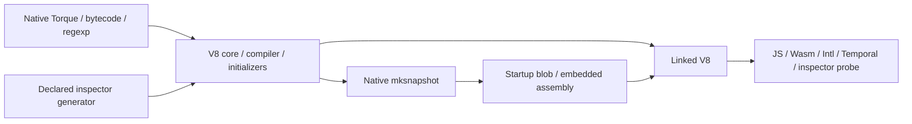
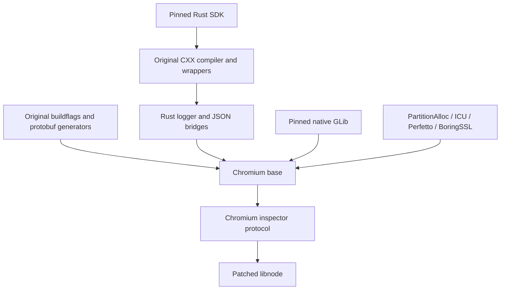
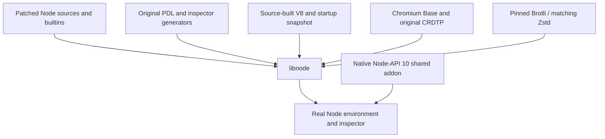

# Electron source import

This overlay builds native Electron source components, including the complete
V8 engine, generated snapshots, Chromium base and patched libnode. No target
currently links a full Electron executable. Source pins and build inputs live in
`bcr/overlay/source`.
Stage a local registry first as shown in the root README; add its registry flags
to every Bazel command below. Native source work:

- Electron 39.0.0, Chromium 142.0.7444.52 commit
  `7efca501bfcc84657ba2921a852e98ce1fb37641`, Node 22.20.0 and V8
  `bb294624702efbb17691b642333f06bf5108e600` are pinned.
- Bazel applies all 14 ordered patch stacks: 236 upstream patches. Exact
  revisions and patch filenames live in upstream_pins.json; 718 modified source
  files are checked against patch_fingerprints.json.
- Patched libuv builds/links for five platforms; Linux test executes its
  Electron-specific loop-interrupt API. Windows uses MSVC.
- Real patched JS2C builds and emits embedder builtin C++ with separate host
  execution configuration. Full Node builtin generation also produces all
  370 registered modules, including 14 real original-fs outputs and target
  config.gypi. The config output matches upstream's GN-driven script
  byte-for-byte. This configuration is Linux AMD64 only; independent original-fs
  and embedder producers also execute under a Windows ARM64 target configuration.
  Electron fuse and Chromium buildflag generators
  produce actual Electron C++; native fuse-wire/default test passes. Full
  patched BoringSSL crypto/TLS compiles and passes RIPEMD160, cipher lookup
  and AES-CFB roundtrip checks. Crypto/TLS also cross-links all five platforms;
  Linux GNU 2.31 probe executes. Real Node macro-isolation generation passes
  a compiled push/undef/pop integration test.
- GN 2285 (`81b24e01531e`) loads 27,558 targets. Chromium's strict capture tool
  validates the complete 11,955-target Electron closure, 4,570 runtime entries
  and generated-file contents. `native/linux_amd64.partial.json.gz` records
  exact tool hashes, arguments, all 14 applied patch groups and fingerprint hash.

The metadata tree reuses matching-DEPS checkout files read-only. It must not
be used to compile or package Electron. All Electron patch groups are now
applied, including nested Squirrel/Mantle/ReactiveObjC dependencies. Other
Chromium dependencies still need explicit source/Bazel declarations before
full native translation. Other four source graphs also remain. No GN/Ninja
build runs inside Bazel actions.

Patched `//third_party/electron_node:libnode` now builds its 171 C/C++ units and
executes a real embedding probe. Next native producer:
`//electron:electron_lib` has 315 units plus its Chromium dependency closure. Node's `run_node_js2c`,
`generate_config_gypi` and `node_js2c_original_fs` now have native Bazel
producers. All eight Electron webpack bundles now build using actual upstream
configurations, captured buildflags and 141 integrity-pinned packages
from its exact yarn.lock. Pinned Node 22.20.0 comes from rules_nodejs execution
toolchains; this bootstrap is an official runtime, not source-built Node.
These bundles currently transpile without typechecking; TypeScript definition
generation remains unfinished. `@electron//source:electron_natives` runs actual C++ JS2C
with all eight canonical `electron/js2c/*` module names.
The remaining Chromium import needs matching Blink/content libraries and
runtime packaging. No target currently links a source-built
Electron executable.

`bazel test @electron//tests:node_builtins_test` runs the actual full Node producer
chain. It checks regular fs and isolated original-fs registration/payloads,
native module ABI 140, NAPI 10, V8 sandbox/pointer compression and target
configuration embedded as JSON. No GN process runs inside these actions.

`@electron//tests:electron_bundles_test` parses all eight emitted bundles with
pinned Node and verifies lossless one-byte and two-byte C++ embedding. Earlier
app-level bundle smoke used official Electron binaries; that packaging example
now belongs with the future app rules repository. Source tests do not establish
that a source-built Electron runtime launches.

The npm closure includes exact required/optional lock dependencies, explicit
webpack/TypeScript peers and the config's terser import. This is a bounded
Electron source tool closure, not a general npm package manager. Packages copy
into a private staging tree; Node resolves their exact dependency links there.
No install hooks run; sandbox actions deny network on Linux.

The native BoringSSL overlay mirrors Electron's extra crypto source list. Its
GN list includes obsolete `decrepit/ripemd/internal.h`; that nonexistent header
is excluded, and the real `decrepit/macros.h` dependency is declared explicitly.

## Native Node dependencies

The Linux AMD64 profile declares Ada, c-ares, HdrHistogram, llhttp, nbytes, ncrypto,
nghttp2, Postject, simdjson, SQLite and uvwasi from the pinned patched Node tree.
Ten compiled libraries contain 136 C/C++ units; Postject is header-only. All
effective definitions and language-specific options come from the verified GN
capture. Hermetic LLVM supplies compiler/sysroot/libc++; omitted global include
roots and toolchain/diagnostic flags remain recorded. Unsupported dependency
edges fail import rather than substituting another library version.

`@electron//source:node_dependencies_test` consumes all eleven libraries and checks
URL/JSON/HTTP parsing, IPv6 conversion, histogram recording, HTTP/2 settings,
SQLite FTS5/session configuration and WASI argument transfer.
[9395812 source components](https://formatjs.buildbuddy.io/invocation/6f893782-be77-4e46-a6ff-030d79cdc260)
and [BCR consumer](https://formatjs.buildbuddy.io/invocation/52bfde1b-8468-476d-9866-109a133c1935)
both passed compilation and the linked probe. This does not link libnode or
Electron. Other target profiles remain unsupported for these libraries.

ncrypto uses the existing Electron-patched BoringSSL provider; its GN include
mapping remains recorded. The linked probe also checks unaligned byte swaps
and invalid lengths, the
[RFC 5869 A.1 HKDF vector](https://www.rfc-editor.org/rfc/rfc5869.html#appendix-A.1)
and output-length limits, plus Postject lookup of a declared ELF note and missing
resources. The execution toolchain assembles the fixture note, linked statically
into the main test executable because Postject searches that executable. No host
binary editing tool or alternate crypto runtime is used.

Regenerate the inventory from the same graph:

```sh
python3 tools/capture_node_deps.py --graph=bcr/overlay/source/native/linux_amd64.partial.json.gz \
  --output=bcr/overlay/source/native/node_deps_inputs.bzl
buildifier bcr/overlay/source/native/node_deps_inputs.bzl
```

## Complete Torque generation

`@electron//source:v8_torque` builds the matching Torque compiler from 25 captured
C++ units and translates all 246 upstream `.tq` inputs into 1,250 declared engine
outputs. It preserves captured source order, exceptions/RTTI and Electron's
sandbox, Temporal, Intl and Perfetto definitions. Hermetic LLVM replaces source
toolchain/sysroot options; original dependencies, includes and omitted flags
remain recorded. No default V8 feature profile substitutes for this capture.

The action invokes the execution compiler directly through declared Python,
using stable source-relative arguments. The initial profile runs twice under
different source/output paths and input mtimes, then requires byte equality for
every output. A manifest records profile provenance and output hashes; output
groups expose headers and C++ sources for the remaining engine build. Tests
check generated engine/Intl/Temporal interfaces and malformed-input rejection.
Torque embeds its V8 root in source locations, so the runner passes `.` from
each isolated source directory. It also creates every declared output parent;
the upstream compiler assumes those directories already exist.

[93dc092 source components](https://formatjs.buildbuddy.io/invocation/0a295b37-7dc5-4a45-b395-e8e210eb1620)
and [BCR consumer](https://formatjs.buildbuddy.io/invocation/e338b62e-75ae-4a3e-b5fd-21279b2f4cd3)
passed complete generation, byte reproducibility, output hash/interface checks
and the real parser diagnostic/abort check. Core dumps are disabled for that
negative test. The cross-compile workflow also passed; this Torque profile
itself remains Linux AMD64. Full engine validation is recorded below; libnode
and the Electron executable remain unfinished.

```sh
python3 tools/capture_v8_torque.py --graph=bcr/overlay/source/native/linux_amd64.partial.json.gz \
  --output=bcr/overlay/source/native/v8_torque_inputs.bzl
buildifier bcr/overlay/source/native/v8_torque_inputs.bzl
```

## Bytecode handler generation

`@electron//source:v8_bytecodes` builds the captured three-unit upstream
generator and emits `builtins-generated/bytecodes-builtins-list.h`. Interpreter
support is shared with a compiled probe; Torque and bytecode tools share the
same pinned header provider. All effective definitions and language options
come from the Electron graph. No GN wrapper, system interpreter or alternate
V8 profile runs in the generation action.

`@electron//source:v8_bytecodes_test` compiles the actual generated handler
macro and checks every opcode at all three operand scales against V8's
interpreter API: handler names, coverage, uniqueness, illegal wide encodings
and dense wide/extra-wide dispatch indices. A second generation uses a
different output path containing spaces; the probe compares all bytes.
Production consumers depend only on the first generation. Hosted validation
passed in [1395ef7 components](https://formatjs.buildbuddy.io/invocation/939077e6-f2cf-4874-8d8f-99b8becb0f72)
and [BCR consumer](https://formatjs.buildbuddy.io/invocation/4dedcd9e-2880-4aec-8a0e-d2fbacf123e4),
including the existing full Torque checks. This does not link the V8 engine.

```sh
python3 tools/capture_v8_bytecodes.py --graph=bcr/overlay/source/native/linux_amd64.partial.json.gz \
  --output=bcr/overlay/source/native/v8_bytecode_inputs.bzl
buildifier bcr/overlay/source/native/v8_bytecode_inputs.bzl
```

## Regexp special-case generation

`@electron//source:v8_regexp` builds the captured `gen-regexp-special-case`
execution tool against matching patched V8 and Chromium ICU, then emits real
`src/regexp/special-case.cc`. It preserves the complete Electron definitions and
source flags. Bytecode and regexp generation share a direct Bazel action;
neither invokes the GN Python wrapper.

The compiled `@electron//source:v8_regexp_test` consumes those generated tables
and disables ambient ICU data-file access. It checks legacy ignore-case
matching for Kelvin sign, long s, sharp s, Greek mu and ordinary ASCII, plus
surrogate/canonicalization boundaries. A second output path contains spaces;
every generated byte must match.
[b98e496 components](https://formatjs.buildbuddy.io/invocation/3bc9b5ed-9f34-4053-ba0f-808adc539d5b)
and [BCR consumer](https://formatjs.buildbuddy.io/invocation/e936e28b-4f42-4864-96be-8c7127086717)
passed these checks and existing source tests. Cross-compile CI also passed;
this producer remains Linux AMD64.

V8's repository BUILD file now delegates to a stable source macro. Further
native rule edits do not need to change the BUILD template read during source
repository setup. The existing bytecode inventory regenerates byte-for-byte
after sharing its capture logic with the new generator. Full V8/Electron
linking remains unfinished.

```sh
python3 tools/capture_v8_generators.py --generator=regexp \
  --graph=bcr/overlay/source/native/linux_amd64.partial.json.gz \
  --output=bcr/overlay/source/native/v8_regexp_inputs.bzl
buildifier bcr/overlay/source/native/v8_regexp_inputs.bzl
```

## Matching Chromium ICU

`@electron_icu_sources//:icu` declares all 445 captured C++ units: 202 common
units, including upstream stub data, and 243 i18n units. Source revision
`1b2e3e8a421efae36141a7b932b41e315b089af8` and archive integrity match
formatjs/chromium's ICU overlay; repository setup also verifies the revision
against Electron's patched Chromium DEPS. Compile options, RTTI, definitions,
headers and dependency edges come from this Electron capture.
The header inventory includes GN's separate public lists and the real
`stubdata.h` include omitted from those lists. Upstream subset Bazel packages
are replaced by this captured graph; ICU sources and data remain unchanged.

The profile retains file-backed data. `common/icudtl.dat` is declared runtime
data for later packaging, rather than host ICU data or a different
ICU version. `@electron//source:icu_test` disables ambient data-file loading,
rejects corrupt common data, then initializes from that declared file. It
checks NFC composition, case-fold preflight/expansion, collation strengths,
French number formatting and Chromium's patched word-break behavior.
[fe62420 source components](https://formatjs.buildbuddy.io/invocation/63616e6c-424b-4f71-8962-5903b4a10113)
and [BCR consumer](https://formatjs.buildbuddy.io/invocation/23d317a4-9381-4466-a904-6afb3bb4a61d)
passed all compilation and these behavior checks; cross-compile CI also passed.
This captured ICU profile itself remains Linux AMD64. Its repository rule is
separate from Node/V8 repository implementations so future ICU setup edits do
not change their definition files. `//:source_components` requests both actual
ICU archives through `//source:icu_libraries`; building the dependency-only C++
provider alone would not request both archives. The full engine now consumes
these archives; final Electron linking remains unfinished.

The build-only component phase uses `--remote_download_outputs=minimal` so
compile-only archives remain in BB CAS. The following test phase retains
top-level downloads for its executables and declared runtime data.

```sh
python3 tools/capture_icu.py --graph=bcr/overlay/source/native/linux_amd64.partial.json.gz \
  --output=bcr/overlay/source/native/icu_inputs.bzl
buildifier bcr/overlay/source/native/icu_inputs.bzl
```

## Captured PartitionAlloc

Temporal's Rust closure uses Chromium's allocator. The matching native
PartitionAlloc profile contains 66 C++ units across allocator base, core and
shim archives. An isolated repository projects these source bytes read-only
from the exact patched Chromium tree; it downloads no alternate version.
Captured flags and upstream buildflag generation retain the malloc shim,
backup-ref-pointer and thread-isolation settings.

`@electron//source:partition_alloc_test` links the real shim and checks heap
ownership, allocation/zeroing, realloc preservation and failed-realloc safety,
overflow handling and aligned allocation/reallocation. A child process checks
the upstream SIGILL trap on calloc multiplication overflow and SIGTRAP on
allocation-metadata overflow, with core dumps disabled. A valid huge request
and failed realloc must still return null.
It also checks that
ordinary `malloc` and C++ `new` use PartitionAlloc. No replacement allocator or
allocation stub supplies this prerequisite.
[5b7f211 source components](https://formatjs.buildbuddy.io/invocation/c0fd8cbf-f5c9-4994-a64a-c6dec789b10b)
and [BCR consumer](https://formatjs.buildbuddy.io/invocation/e50d8faf-cf75-49ac-8891-b726caf63db5)
passed archive compilation and all probe boundaries. Cross-compile CI also
passed; this PartitionAlloc profile itself is Linux AMD64. The following
Temporal slice now links this allocator through its original Rust bridge.

```sh
python3 tools/capture_partition_alloc.py \
  --graph=bcr/overlay/source/native/linux_amd64.partial.json.gz \
  --output=bcr/overlay/source/native/partition_alloc_inputs.bzl
buildifier bcr/overlay/source/native/partition_alloc_inputs.bzl
```

## Temporal Rust and allocator FFI

The captured Temporal closure declares 57 Rust targets from 44 pinned vendor
packages, including six original build scripts, proc macros and both allocator
variants. Three C++ bridge variants use Chromium's original allocator/error
handler sources. Runtime Rust keeps `rust_allocator_uses_allocator_impls_h` and
real PartitionAlloc-backed FFI; host variants retain their captured settings.
Native bindgen generates the original `bindings.rs` namespace wrapper inputs.

`hermeticbuild/rules_rs` 0.2.1 supplies native Rust actions. Development and BCR
consumer configurations register nightly/2025-09-25 and select the nightly
channel. Compiler target/metadata choices come from those declared providers;
captured features, editions, codegen and warning options remain explicit.
Source projection lists every crate input, checks Cargo.toml versions and maps
generated OUT_DIR/CARGO_MANIFEST_DIR paths. Dependencies come from the captured
graph; original build scripts run against declared inputs.

The one-unit V8 `ZoneInfo64Provider` uses its real upstream implementation and
the captured engine flags. `@electron//source:temporal_test` initializes declared
ICU data with ambient data-file loading disabled, then checks Rust allocation
ownership and fallible reserve, leap dates, rejection/constraining, calendar
arithmetic, Japanese calendar data and New York DST/gap behavior through that
actual provider.
[3278609 source components](https://formatjs.buildbuddy.io/invocation/df7fed7a-c08b-46f4-be2d-dcb6467631df),
[BCR consumer](https://formatjs.buildbuddy.io/invocation/75b513b8-c73b-4fb4-a035-0122c0ed452d)
and [cross-compile checks](https://formatjs.buildbuddy.io/invocation/a9818842-360f-4d7f-ad60-29fd3732546c)
passed. This Linux AMD64 slice does not link the full V8 or Electron engine.

```sh
python3 tools/capture_temporal.py \
  --graph=bcr/overlay/source/native/linux_amd64.partial.json.gz \
  --source-root=/path/to/matching/patched/chromium \
  --output=bcr/overlay/source/native/temporal_inputs.json \
  --v8-output=bcr/overlay/source/native/v8_temporal_inputs.bzl
buildifier bcr/overlay/source/native/v8_temporal_inputs.bzl
```

## Full V8 engine and snapshots

The complete patched V8 engine now builds, links and executes. Native consumers
use `@electron_v8_engine_sources//:v8`, `:platform` and declared `:runtime` data.
Its 34 native targets add 1,453 C++/assembly compilation units; existing
libbase/libm and execution generators remain shared dependencies. Inspector uses
original compatibility checks, templates and declared Jinja2/MarkupSafe inputs.
FP16 uses Chromium's exact DEPS revision and a hashed archive.



The profile projects 3,047 declared files. Generated layout aliases reuse
all 1,250 Torque outputs and the existing native producer. Snapshot creation
keeps the captured architecture/OS, predictable mode and seed `314159265`.
Upstream `mksnapshot` calls `CpuFeatures::Probe(true)`, disabling host CPU
probing for target code generation. Each native Python action, including
snapshot generation, requires byte equality across changed staging paths and
input mtimes. `:runtime` exposes the generated startup blob and matching ICU data.

The hermetic SDK needs explicit `<atomic>`/`<memory>` includes in Wasm `pgo.h`.
`v8_header_compat.patch` applies only to an owned projection copy; parent patched
V8 sources stay unchanged. `native_toolchain_patches.json` records that boundary.
The shared header provider exposes matching native Abseil dependencies instead
of relying on GN's implicit include-root access. Captured feature flags remain
intact, including pointer compression, sandbox, Intl and Perfetto.

`@electron//source:v8_engine_test` initializes the actual generated snapshot and
ICU data, executes a Wasm add function, JS collection operations, Unicode/locale
behavior and Rust-backed Temporal DST/rejection paths. It dispatches inspector
`Runtime.evaluate`, checks the decoded result, tests syntax-error reporting and
checks context state after collection.
[4516ed7 components](https://formatjs.buildbuddy.io/invocation/4d39e515-418d-4f13-a1ec-2a4b5484c4d0),
[BCR consumer](https://formatjs.buildbuddy.io/invocation/ec9a0537-868a-4182-9ec0-ded5e613b4ef)
and [cross checks](https://formatjs.buildbuddy.io/invocation/4340b427-110a-46b5-a4be-84f4828020d0)
passed. This full engine profile remains Linux AMD64. Patched libnode,
Electron/Chromium content linking and complete runtime packaging remain open.

```sh
python3 tools/capture_v8_engine.py \
  --graph=bcr/overlay/source/native/linux_amd64.partial.json.gz \
  --v8-root=/path/to/matching/patched/v8 \
  --chromium-root=/path/to/matching/patched/chromium \
  --fp16-root=/path/to/pinned/FP16 \
  --output=bcr/overlay/source/native/v8_engine_inputs.json
```

## Complete captured Perfetto closure

The native profile translates all 329 captured Perfetto targets plus matching
JsonCpp: 68 original generator actions, 721 generated outputs and 564 C++
compilation units, including generated protocol implementations and host
plugins. Source sets retain object inclusion semantics; each target keeps its
captured compiler flags, definitions and dependencies.

Perfetto comes from Electron's patched `d5bbee7afdf259af4212929ccbff467dd5349953`
source. JsonCpp uses Chromium's exact DEPS revision
`42e892d96e47b1f6e29844cc705e148ec4856448` and a hashed archive, rather than a
newer BCR version. Its iterator `.inl` is a declared implementation input.
The projection declares 1,463 source/header/schema/script/license files.

The original protoc wrapper, buildflag writer, descriptor/table generators and
stamp script run through a declared Python action. Native protoc/plugins are
execution-platform inputs. Child processes get isolated Python, empty `PATH`
and an explicit environment. Every generator runs twice with different staging
paths, including spaces, and different source mtimes; output bytes must match.
The registered LLVM toolchain supplies the compiler-runtime archive formerly
named through GN's `$LLVM_ROOT`; no source action resolves that host path.

`@electron//source:perfetto_test` starts/stops real in-process tracing, decodes
packet-scoped interned names and debug annotations, and checks disabled-category
filtering. It also checks binary-string JsonCpp roundtrips and its captured
abort-on-invalid-conversion behavior, with core dumps disabled.
[7177c35 components](https://formatjs.buildbuddy.io/invocation/3072778c-6b5f-4d26-ad16-aa721e45c7f4),
[BCR consumer](https://formatjs.buildbuddy.io/invocation/781d378c-801e-46f9-a1a9-45bfd2007deb)
and [cross checks](https://formatjs.buildbuddy.io/invocation/73a5d16b-bf93-4f1a-8e97-25159bb6bb41)
passed. These native profiles remain Linux AMD64. The full engine now consumes
this tracing closure; final Electron linking remains open.

```sh
python3 tools/capture_perfetto.py \
  --graph=bcr/overlay/source/native/linux_amd64.partial.json.gz \
  --chromium-root=/path/to/matching/patched/chromium \
  --perfetto-root=/path/to/matching/patched/perfetto \
  --jsoncpp-root=/path/to/pinned/jsoncpp \
  --output=bcr/overlay/source/native/perfetto_inputs.json
```

## Matching Protobuf runtime and compiler

Perfetto's generators require a matching protocol tool/runtime. The native
profile builds Chromium's embedded Protobuf 32.0 rather than substituting the
newer BCR module. Twelve original targets contain 129 C/C++ units: UTF-8 support,
full/lite runtimes, protoc, its C++/Java/Python compiler libraries and the original
JavaScript plugin dependency. That plugin uses Chromium's exact DEPS revision
`e6d763860001ba1a76a63adcff5efb12b1c96024` with a hashed archive.

The profile declares 1,110 source/header/schema/license files, preserves captured
compiler flags and keeps `GOOGLE_PROTOBUF_NO_RTTI` and
`PROTOBUF_INTERNAL_BOUNDS_CHECK_MODE_ABORT` consistent through generated code.
Abseil comes from the matching Chromium tree. Its public `base` target carries
the private raw-logging dependency; no visibility override or duplicate source
copy is needed. Protoc is an explicit execution-platform binary with its plugin
runfiles. Source sets keep their object inclusion semantics.

`@electron//source:protobuf_test` compiles full and lite schemas using that
source-built protoc. It checks packed signed values, binary maps, oneof/optional
presence, full/lite unknown-field preservation, dynamic reflection, truncated
messages, malformed packed fields and invalid UTF-8.
[687dc7f components](https://formatjs.buildbuddy.io/invocation/a70db8a5-8eee-417a-9cfd-53c1564ad657),
[BCR consumer](https://formatjs.buildbuddy.io/invocation/e87c3f3f-4c89-4a11-9d22-0ce75b75d180)
and [cross checks](https://formatjs.buildbuddy.io/invocation/21521a1e-126f-4532-a745-8c2b84650786)
passed. These new profiles remain Linux AMD64. Perfetto's protocol/runtime
closure now uses this matching compiler and runtime.

```sh
python3 tools/capture_protobuf.py \
  --graph=bcr/overlay/source/native/linux_amd64.partial.json.gz \
  --chromium-root=/path/to/matching/patched/chromium \
  --javascript-root=/path/to/pinned/protobuf-javascript \
  --output=bcr/overlay/source/native/protobuf_inputs.json
```

## V8 number, SIMD and compression dependencies

Twelve captured targets expose Dragonbox, fast_float, Highway, simdutf and
Chromium zlib, including all four zlib SIMD helper targets and the portable
compression wrapper. Twenty-nine original C/C++ units retain their captured
language flags and SIMD definitions. Header-only targets remain header-only;
source sets keep their object inclusion semantics.

Dragonbox, fast_float and Highway use exact Chromium DEPS revisions and hashed
archives. Separate source repositories keep archive extraction independent of
profile edits. A read-only projection declares 179 source/header/license inputs;
simdutf, zlib and build headers come from the matching Chromium archive.
`tools/capture_v8_support.py` checks DEPS pins and rejects unknown dependencies,
source paths and include roots. Its `--help` lists the required source roots.

`@electron//source:v8_support_test` checks shortest-decimal roundtrips through
Dragonbox and fast_float, including subnormal/minimum/maximum doubles, overflow
and invalid input. It checks Unicode conversion and malformed UTF-8, Highway CPU
discovery/aligned memory, zlib/gzip/raw compression roundtrips, undersized output,
corrupt checksummed streams and CRC32/Adler32 vectors.
[51e5642 components](https://formatjs.buildbuddy.io/invocation/37462791-7cbe-4105-8610-3bfde508c7bc),
[BCR consumer](https://formatjs.buildbuddy.io/invocation/11a4a3fd-25ce-4651-8115-0773a0923553)
and [cross checks](https://formatjs.buildbuddy.io/invocation/7766ab37-94e9-43d4-94f9-3c0f1469505e)
passed. The new library profiles themselves remain Linux AMD64. The full engine
now consumes them; Node/Electron integration remains open.

## Native V8 base/task slice

`@electron_v8_sources//:libbase` compiles all 40 captured Linux AMD64 source
units; `:libm` compiles all three C units. `:platform_tasks` compiles five real
libplatform queue/foreground/worker units. These are static archives, using the
exact patched V8 revision and captured GN definitions. Source toolchain/sysroot
paths and warning-as-error policy are replaced by hermetic LLVM; every omitted
option remains recorded in `native/v8_base_inputs.bzl`. New Clang deprecation
warnings from pinned Abseil are expected and do not change source semantics.

`@electron_abseil_sources` exposes native Bazel rules from Abseil embedded in
the verified Chromium archive. It downloads no alternate Abseil version. The
GTest production header uses a real forwarding include to the declared BCR
header dependency. No substitute platform/tracing headers or functions exist.

`bazel test @electron//source:v8_tasks_test` executes 32 immediate worker tasks, delayed
worker/foreground scheduling, queue termination and captured libm sin/cos.
Only Linux AMD64 is supported by this native profile. Full libplatform still
needs Electron-patched Perfetto tracing and the remaining platform sources;
this slice does not initialize a V8 isolate or link Electron.

Refresh its exact inventory after graph capture:

```sh
python3 tools/capture_v8_base.py --graph=bcr/overlay/source/native/linux_amd64.partial.json.gz \
  --output=bcr/overlay/source/native/v8_base_inputs.bzl
buildifier bcr/overlay/source/native/v8_base_inputs.bzl
```


## Reproduce Linux metadata

From this repository, materialize source repositories and native generators:

```sh
bazel build @electron//source:chromium_patches @electron//source:v8_patches \
  @electron//source:embedder_javascript @electron//source:dependency_patches \
  @electron_node_sources//:electron_patches.json \
  @electron_cast_core_sources//:proto/proto.gni \
  @electron_glslang_sources//:BUILD.gn
electron_output_base=$(bazel info output_base)
electron_repositories="$electron_output_base/external"
electron_capture_dir=$(mktemp -d)
electron_source_root="$electron_capture_dir/src"
```

Set these to existing matching-DEPS Chromium source, pinned GN, hermetic LLVM
and actual rules_rs nightly compiler roots. Verified local setup:

```sh
electron_deps_cache=/tmp/chromium-migration-source
electron_gn=/tmp/chromium-gn/gn
electron_llvm_root="$electron_repositories/llvm++llvm_toolchain_minimal+llvm-toolchain-minimal-linux-amd64"
electron_chromium_tools=/home/dev/bcr_overlays/tools
# rules_rs nightly/2025-09-25, reporting rustc 1.92.0-nightly caccb4d03.
electron_rust_root=/tmp/chromium-ci-root-bazel/4885d5fc792b2938a031e6df2b5a1a5e/external/rules_rs++toolchains+rustc_linux_x86_64_nightly_2025_09_25

python3 - "$electron_repositories" "$electron_deps_cache" "$electron_source_root" <<'PY'
import json, subprocess, sys
from pathlib import Path
repositories, cache, destination = map(Path, sys.argv[1:])
def repository_path(name):
    if name == 'electron':
        return repositories / 'electron+'
    matches = list(repositories.glob('*+' + name))
    if len(matches) != 1:
        raise ValueError(f'Expected one repository for {name}: {matches}')
    return matches[0]
args = ['python3', 'tools/prepare_source.py',
        '--chromium=' + str(repository_path('electron_chromium_sources')),
        '--electron=' + str(repository_path('electron')),
        '--node=' + str(repository_path('electron_node_sources')),
        '--v8=' + str(repository_path('electron_v8_sources')),
        '--deps-cache=' + str(cache), '--destination=' + str(destination),
        '--patch-fingerprints=bcr/overlay/source/patch_fingerprints.json']
for entry in json.loads(Path('bcr/overlay/source/upstream_pins.json').read_text()):
    if entry['group'] in {'chromium', 'node', 'v8'}:
        continue
    name = 'electron_' + entry['group'].lower().replace('.', '_').replace('-', '_') + '_sources'
    args.append('--dependency=' + entry['repo'].removeprefix('src/') + '=' + str(repository_path(name)))
for path, name in [('third_party/cast_core/public/src', 'electron_cast_core_sources'),
                   ('third_party/glslang/src', 'electron_glslang_sources')]:
    args.append('--dependency=' + path + '=' + str(repository_path(name)))
subprocess.run(args, check=True)
PY
mkdir -p "$electron_source_root/out/bazel-import"
cat > "$electron_source_root/out/bazel-import/args.gn" <<EOF
import("//electron/build/args/all.gn")
is_debug = false
is_component_build = false
is_official_build = false
symbol_level = 0
chrome_pgo_phase = 0
target_os = "linux"
target_cpu = "x64"
override_electron_version = "39.0.0"
clang_base_path = "$electron_llvm_root"
clang_version = "23"
clang_use_chrome_plugins = false
rust_sysroot_absolute = "$electron_rust_root"
rustc_version = "$("$electron_rust_root/bin/rustc" -V)"
angle_build_tests = false
EOF
"$electron_gn" gen "$electron_source_root/out/bazel-import" \
  --root="$electron_source_root" --root-target=//electron:electron \
  --ide=json --json-file-name=project.json
"$electron_gn" desc "$electron_source_root/out/bazel-import" \
  //electron:electron_app runtime_deps --format=json \
  --root="$electron_source_root" --root-target=//electron:electron \
  > "$electron_capture_dir/runtime-raw.txt"
```

GN prints an unused `enable_linux_installer` warning before JSON because the
root target excludes Chromium installers. Preserve that warning separately;
extract JSON into a clean file before invoking the serializer:

```sh
python3 - "$electron_capture_dir" <<'PY'
import json, sys
from pathlib import Path
directory = Path(sys.argv[1])
raw = (directory / 'runtime-raw.txt').read_text()
(directory / 'runtime.json').write_text(json.dumps(json.loads(raw[raw.index('{\n'):])))
PY
python3 tools/capture_source.py --chromium-tools="$electron_chromium_tools" \
  --source-root="$electron_source_root" --llvm-root="$electron_llvm_root" \
  --rust-root="$electron_rust_root" --gn="$electron_gn" \
  --runtime-deps="$electron_capture_dir/runtime.json" \
  --patch-fingerprints=bcr/overlay/source/patch_fingerprints.json \
  --output=bcr/overlay/source/native/linux_amd64.partial.json.gz
```

Cast Core uses an exact Git commit: its Gitiles archive stream returned
different SHA256 values for the same URL. GLSLang uses Chromium DEPS revision
`a57276bf558f5cf94d3a9854ebdf5a2236849a5a`, rather than ANGLE's standalone
revision. Both are real source repositories, with no placeholder GN files.

After recapturing the graph, refresh Node settings and exact builtin inventory:

```sh
"$electron_gn" args "$electron_source_root/out/bazel-import" --list --short \
  --root="$electron_source_root" \
  > "$electron_capture_dir/node-gn-args.txt"
python3 tools/capture_node_inputs.py \
  --graph=bcr/overlay/source/native/linux_amd64.partial.json.gz \
  --gn-args="$electron_capture_dir/node-gn-args.txt" \
  --generator="$electron_source_root/third_party/electron_node/tools/generate_config_gypi.py" \
  --settings=bcr/overlay/source/native/node_config_linux_amd64.json \
  --inventory=bcr/overlay/source/native/node_inputs.bzl
buildifier bcr/overlay/source/native/node_inputs.bzl
```

Refresh the bounded webpack lock/inventory from the same verified graph:

```sh
python3 tools/capture_webpack_deps.py --electron="$electron_source_root/electron" \
  --graph=bcr/overlay/source/native/linux_amd64.partial.json.gz \
  --lock=bcr/overlay/source/native/webpack_lock.json \
  --inventory=bcr/overlay/source/native/webpack_inputs.bzl \
  --flags=bcr/overlay/source/native/electron_buildflags.bzl
buildifier bcr/overlay/source/native/webpack_inputs.bzl bcr/overlay/source/native/electron_buildflags.bzl
```

## Chromium base prerequisite

Node's original Chromium inspector protocol implementation depends on complete
`//base:base`. The native capture keeps that implementation and translates its
425-unit root plus support libraries: 448 C/C++ units total. The profile records
all source flags and omitted GN toolchain paths. Native LLVM replaces sysroot
compiler flags; pinned source-built GLib supplies Linux desktop interfaces.
Linux syscall support matches Chromium's exact `ed31caa` DEPS revision.



`electron_base_sources` projects declared files read-only. Generated build dates
use the captured fixed timestamp; version generation consumes declared version
files. Python generators retain isolated interpreters, empty child `PATH`,
explicit environments and path/mtime byte checks. CXX configuration comes from
the pinned target Rust compiler; the CXX executable uses the execution platform.
Cargo does not resolve dependencies. The combined Temporal/base closure contains
85 Rust targets from 65 vendored packages; existing Temporal crates stay shared.

The linked probe exercises original Rust JSON parsing, strict/malformed input
rejection, JSON serialization, Base64 and native GLib task/idle dispatch.
[4746f81 components](https://formatjs.buildbuddy.io/invocation/88a49452-4b2d-4562-b922-e1cd177016cb),
[consumer](https://formatjs.buildbuddy.io/invocation/37a9576f-eea3-4c65-8205-6dabc9b3426e)
and [cross-compile](https://formatjs.buildbuddy.io/invocation/56160928-3964-45f8-9578-6cd78f14d964)
checks passed. Base itself remains Linux AMD64; the cross check covers existing
platform probes. Complete libnode and Electron linking remain separate work.

Base also links PartitionAlloc's original two-unit `raw_ptr` implementation.
This is distinct from its 66-unit allocator/shim closure. Its private headers
stay separate from the existing allocator header target, keeping the full V8
engine's action inputs unchanged during this extension.

## Patched libnode and native inspector

`electron_libnode_sources` translates the 171-unit patched libnode source set,
original Chromium inspector protocol implementation and matching Brotli/Zstd
libraries: 239 C/C++/assembly units total. Existing V8, Base, ICU, BoringSSL,
libuv, eleven Node dependencies and both JS2C outputs stay shared.



Native actions declare the PDL files read by Node's actual inspector config,
including a read-only alias to the matching patched V8 PDL. They also declare
the original generator's imported `Runtime.h`, omitted from captured GN outputs.
Zstd compression is an explicit extra native dependency: Node 22.20 exposes
compression APIs, while the captured GN edge only names the decoder. The
profile preserves original GN outputs/dependencies alongside these additions.
Zstd uses Chromium's exact `89d685e` DEPS revision and an integrity-pinned archive.
No stock Node/V8 source tree substitutes for Electron's selected versions.

Generators retain isolated Python, declared Jinja/MarkupSafe sources, empty
child `PATH`, explicit environments and output equality across paths/mtimes.
Compression header groups stay separate from Node headers; static-library and
source-set linkage retain their original distinction. Legacy GNU `-latomic`
resolves to the declared LLVM compiler-rt builtins archive, whose source includes
the atomic implementation. A native `cc_shared_library` builds the
addon; a declared pinned-Python action materializes unchanged bytes in a regular
`.node` file. Symlinking a `.so` is insufficient: Node resolves the real filename
before selecting its loader. Bazel 9 rejects a direct `.node` shared-library
filename, so the final file requires its own declared action.

`node_embed_lifecycle.patch` updates the owned `CommonEnvironmentSetup` copy to
dispose its isolate before unregistering the platform, matching Electron's
existing `NodeMainInstance` ordering. V8 can still request foreground tasks
during disposal. Original parent sources remain unchanged;
`native_compat_patches.json` records this compatibility patch.

The embedding probe initializes an actual Node environment with generated V8
startup data. It checks ABI 140, Node-API 10 shared-addon loading, original-fs,
asynchronous filesystem reads, crypto, Brotli/Zstd round trips and corruption
rejection, in-memory SQLite and inspector `Runtime.evaluate`. Generic 24-byte
atomic compare-exchange/load exercises the actual compiler-rt implementation.
[40b2baf components](https://formatjs.buildbuddy.io/invocation/db60fdd2-5715-468b-aad5-05013a89fa46),
[consumer](https://formatjs.buildbuddy.io/invocation/257b7fb2-b546-4a98-8b6a-6e1cfb45fa73)
and [cross-compile](https://formatjs.buildbuddy.io/invocation/3e5b2b22-6b6f-4636-b582-5bc4efd1af57)
checks passed. libnode itself remains Linux AMD64; cross checks still cover the
existing platform probes. A complete Electron executable and the other full
source profiles remain unfinished.
